# Tombaugh

**A blink comparator for the 102-color sky.**

Tombaugh is a web tool that plays SPHEREx infrared images of any patch of sky as a short movie, so
that things which move or change brightness stand out. Because SPHEREx sees a patch at a different
wavelength in every exposure, Tombaugh predicts what the unchanging sky should look like in each
frame and shows what is left over.

Built by team Missing Mass (Pearce Harshbarger and Reese Harshbarger) for the NASA Space Apps
Challenge 2026, challenge "Planet X and SPHEREx". Not affiliated with or endorsed by NASA.

The name: Clyde Tombaugh found Pluto in 1930 by flipping between two photographic plates of the
same star field in a blink comparator and watching for the dot that jumped. The search he was
hired for was called Planet X.

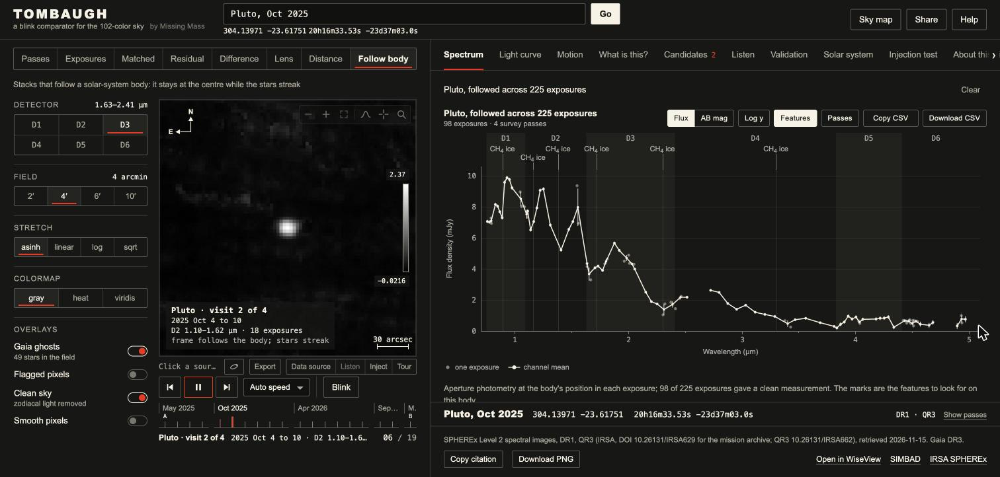

*Real SPHEREx data: Pluto followed across 225 exposures, with the methane-ice bands marked on its
spectrum. Open it yourself: <https://batch-ly.com/tombaugh/index.html?body=pluto>*

| | | |
|---|---|---|
| 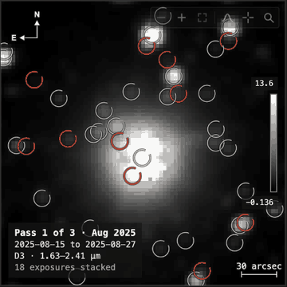 | 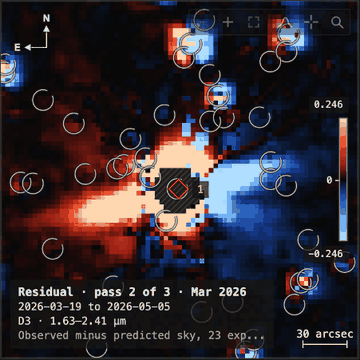 | 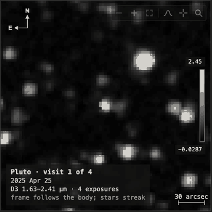 |
| Barnard's Star, one frame per six-month pass. The star steps north, away from its Gaia ring. | The same field with the predicted sky subtracted. What moved is what is left. | Pluto, followed. Each visit has different stars behind it; the stack of all 225 exposures leaves Pluto alone. |

*These three are frames captured from the tool on real SPHEREx data, played in a loop.*

## Results on real data

Measured by the tool itself, in a browser, on real SPHEREx Level 2 images (Data Release 1 and
Quick Release 3) on 15 November 2026. Full tables, controls and limits:
[docs/RESULTS.md](docs/RESULTS.md).

- Five of five challenge targets measured. All 34 comparisons with the catalogues agree within
  3 sigma (Validation tab, "Run the five challenge targets").
- Three fast movers recovered with the right speed and direction, from 6-arcsecond pixels and
  two to four visits.
- Two variables recovered: RW Aurigae rose by 40 %, R Draconis fell by 28 %.
- Methane seen twice: in the T dwarfs Epsilon Indi Ba,Bb, and as ice on Pluto.
- Blind search: every challenge target is the top entry in its own field's candidate list, and
  in four of the five fields the only one. On nine empty control fields the list holds none.
- The search's reach, from planted bodies in real frames: a body at 500 AU is recovered half of
  the time at 51 µJy. A Neptune-size planet there would be about 25 µJy, twice too faint.
- No new object is claimed.

| Target | Tombaugh measures | Catalogue |
|---|---|---|
| Barnard's Star | 11903 ± 2426 mas/yr at 355 ± 12 deg | 10380 mas/yr at 356 deg (+0.6 sigma) |
| Epsilon Indi Ba,Bb | 4511 ± 648 mas/yr at 125.9 ± 8.2 deg; methane band depth 0.600 ± 0.002 | 4635 mas/yr at 123.9 deg (−0.2 sigma) |
| WISE 0855-0714 | 8016 ± 1249 mas/yr at 277.9 ± 8.9 deg | 8169 mas/yr at 274.6 deg (−0.1 sigma) |
| RW Aurigae | brightness ×1.397 ± 0.041 (11.0 sigma), Sep 2025 → Mar 2026; no motion detected | known irregular variable |
| R Draconis | brightness ×0.717 ± 0.056 (4.3 sigma), Mar 2026 → Apr 2026; no motion detected | known Mira variable |

The catalogue motions are what a perfect measurement on the same dates would give, parallax
included (Gaia DR3 for the star; published values for the two brown dwarfs).

| | |
|---|---|
| 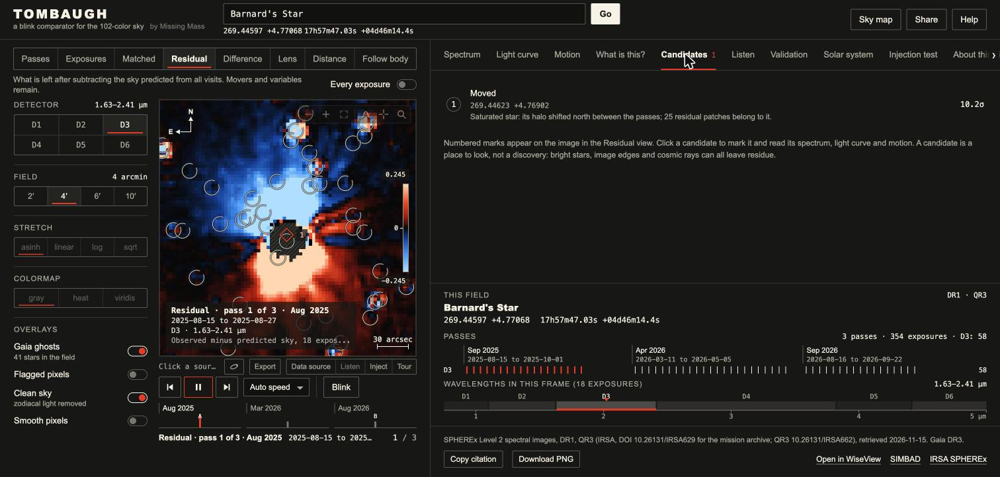 | 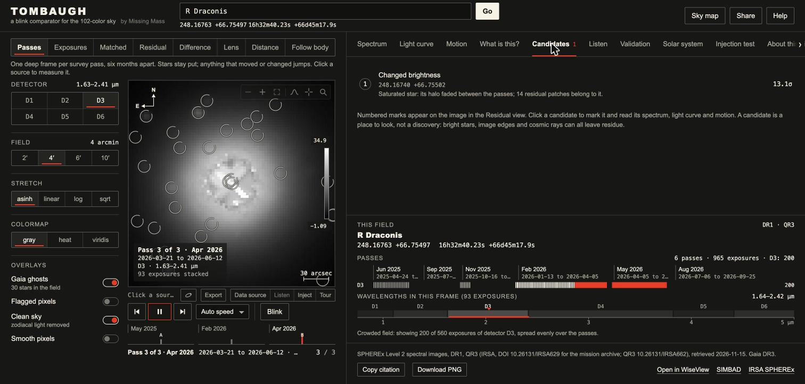 |
| Barnard's Star, residual view. One candidate: "Moved", 10.2 sigma. | R Draconis. One candidate: "its halo faded", 13.1 sigma. |
| 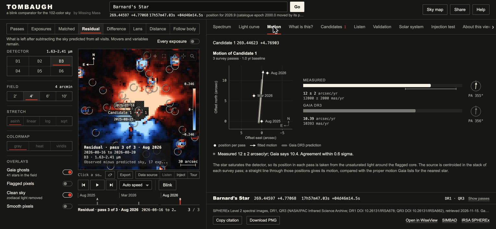 | 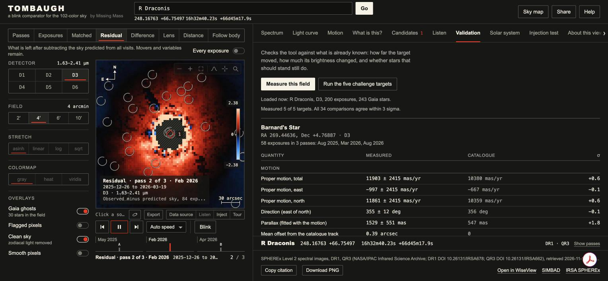 |
| Motion tab: "Measured 12 ± 2 arcsec/yr; Gaia says 10.4. Agreement within 0.6 sigma." | Validation tab: "Measured 5 of 5 targets. All 34 comparisons agree within 3 sigma." |
| 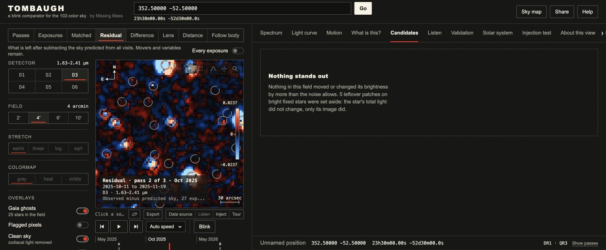 | 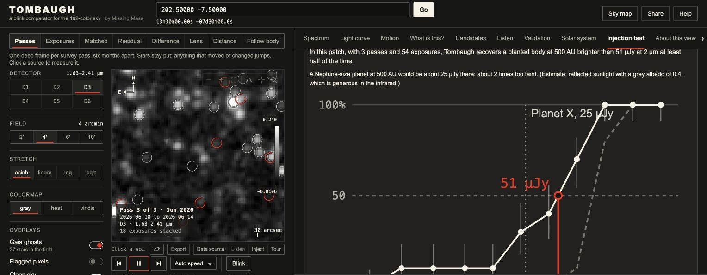 |
| An empty control field. "Nothing stands out. 3 leftover patches on bright fixed stars were set aside." | Injection test on an empty field: half of the bodies planted at 500 AU are recovered at 51 µJy. |

## Try it

Live tool: **<https://batch-ly.com/tombaugh/index.html>**

Type a position (`269.45 4.69`, `17h57m48.5s +04d41m36s`, `17:57:48.5 +04:41:36`) or a name
(`Barnard's Star`), or take the five-target tour from the first screen.

Every view is a link. The state of the page lives in the URL, so a link reproduces what you see and
can be embedded in another page.

| Parameter | Values | Default | Meaning |
|---|---|---|---|
| `ra`, `dec` | decimal degrees (ICRS) | none | Centre of the patch |
| `name` | text | none | Object name, resolved by the proxy: the five challenge targets from a built-in table, anything else through CDS Sesame, then SIMBAD |
| `body` | `pluto`, `ceres`, `eris`, ... or any name JPL Horizons knows | none | Follow a solar-system body: find the exposures that caught it and stack them in its own frame |
| `fov` | `2`, `4`, `6`, `10` | `4` | Field of view in arcminutes |
| `det` | `1` to `6` | `3` | SPHEREx detector (D1 0.75-1.09, D2 1.10-1.62, D3 1.63-2.41, D4 2.42-3.82, D5 3.83-4.41, D6 4.42-5.00 um) |
| `view` | `passes`, `exposures`, `matched`, `residual`, `diff`, `lens`, `distance` | `passes` | What to show (see below) |
| `ch` | `0` to `16` | `8` | Spectral channel within the detector, for `matched` |
| `lens` | `methane`, `water`, `co2`, `co`, `rgb` | `methane` | Molecule lens, for `view=lens` |
| `dist` | astronomical units, or `inf` | `inf` | Distance assumed by the distance dial, for `view=distance` |
| `t` | frame index | `0` | Which frame of the movie is showing |
| `stretch` | `asinh`, `linear`, `log`, `sqrt` | `asinh` | Brightness scaling |
| `gaia` | `0`, `1` | `1` | Gaia DR3 rings on or off |
| `flags` | `0`, `1` | `0` | Pixel-flag overlay on or off |
| `embed` | `1` | off | Hide the page chrome, for iframes |
| `story` | `tour`, `demo`, `barnard`, `eps-indi-b`, `wise0855`, `rw-aur`, `r-dra` | none | Play a guided story |
| `api` | URL | production proxy | Use a different proxy (development) |

Examples:

```
https://batch-ly.com/tombaugh/index.html?body=pluto
https://batch-ly.com/tombaugh/index.html?name=Barnard%27s%20Star&view=residual&det=3&gaia=1
https://batch-ly.com/tombaugh/index.html?ra=133.795129&dec=-7.245147&fov=4&det=6&view=passes
```

The first follows Pluto across 225 real exposures: Pluto holds still, the stars streak, and the
spectrum shows methane ice. The third is the challenge's position for WISE 0855,
08h55m10.831s -7d14m42.53s, in degrees. That is where WISE saw the object in May 2010. It has
moved more than 2 arcminutes west since, which is why the tour centres on its position today and
why a link by `name` is the better one to share.

Embedding:

```html
<iframe src="https://batch-ly.com/tombaugh/index.html?name=Barnard%27s%20Star&view=passes&embed=1"
        width="480" height="560" style="border:0" title="Tombaugh: Barnard's Star"></iframe>
```

Keyboard: space play/pause, arrows step, `b` blink, `r` residual, `g` Gaia, `f` flags, `1`-`6`
detector, `?` help.

## The idea

SPHEREx has no filter wheel. A linear variable filter sits above each of its six detectors, so the
wavelength a pixel sees depends on where the pixel is on the detector. The telescope steps across
the sky and each patch slides down the filter, exposure by exposure. That is how it builds a
102-band spectrum of everything. It also means that **SPHEREx never photographs a patch in the same
colour twice.**

Two consequences for anyone who wants a blink movie:

1. Play the exposures in time order and every star changes brightness from frame to frame, because
   the colour changed, not the star. The movie flickers and the flicker hides real change.
2. A SPHEREx pixel is 6.15 arcseconds across. Barnard's Star, the star with the largest known proper
   motion, moves 10.4 arcseconds a year, about 5 arcseconds between two survey passes. That is
   less than one pixel. Blinking alone will not show it.

```
One pixel of sky, one detector, all its exposures:

  exposure      1       2       3     ...    41      42    ...
  pass        2025-06 2025-06 2025-06      2025-12 2025-12
  wavelength   1.61    1.52    1.31         1.58    1.24   (um, illustrative)

  Naive blink: 1 -> 2 -> 3 ...   brightness jumps because the wavelength jumped.

  Predicted-sky subtraction:

  brightness
      |                  X
      |     o
      |  o .-''''-. o             o  one exposure of this pixel
      |  .'        '-.  o         -  smooth curve fitted through all exposures
      | '    o        '-.         X  an exposure the curve cannot explain
      +------------------------------> ln(wavelength)

  residual(frame) = image(frame) - curve(wavelength of each pixel in that frame)
```

What Tombaugh does instead:

- **Passes.** Group the exposures into survey passes (about six months apart), stack each pass per
  detector, and blink the stacks. Colour averages out; position does not.
- **Predicted-sky subtraction.** For every pixel, fit a smooth spectrum through all exposures of
  one detector. For each frame, predict what the static sky would look like at exactly the
  wavelengths that frame saw, and subtract. A star that stayed put and stayed the same cancels. A
  star that moved leaves a bright-dark pair. A star that varied leaves a pulse.
- **Measure.** Centroid the object in each pass, fit a proper motion, and put the number beside the
  one Gaia measured. That comparison is the tool's check on itself.

The method, its noise model and its failure modes are in [docs/SCIENCE.md](docs/SCIENCE.md).

## What it does, mapped to the challenge

### Objectives

| Challenge asks for | Tombaugh | Where |
|---|---|---|
| A public-facing web tool | One page, no account, no install | <https://batch-ly.com/tombaugh/index.html> |
| Enter RA and Dec | Decimal or sexagesimal coordinates, or a name | Search box; `ra`, `dec`, `name` |
| A series of SPHEREx images of that patch, like a little video | Time-ordered movie of every exposure; movie of per-pass stacks; play, pause, speed, step, blink A/B | `view=exposures`, `view=passes` |
| Easy to spot moving objects | Residual movie; a Candidates tab that lists what changed, with no catalogue input; Gaia rings that a moving star leaves behind; a motion meter compared with Gaia | `view=residual`, Candidates tab, `gaia=1` |
| Test on Barnard's Star, Epsilon Indi B, WISE 0855, RW Aurigae, R Draconis | Five-target tour on the first screen; one button in the Validation tab measures all five against catalogues. Result: 5 of 5 measured, 34 comparisons within 3 sigma | Landing page; Validation tab; [docs/RESULTS.md](docs/RESULTS.md) |

### Optional considerations

| Consideration | Tombaugh | Where |
|---|---|---|
| Easy to update with new releases | Frames are found in this project's own index of NASA's public SPHEREx bucket. A new week of data is added by running the index build, with no code change; the release name is read from each file path | [docs/ARCHITECTURE.md](docs/ARCHITECTURE.md#new-data-releases-without-code-changes) |
| Creative display of the 102 bands; add each of the six detector arrays for signal-to-noise | Per-pass stacks for each detector; wavelength-matched channel view (the same channel across passes); molecule lenses; three-detector colour | `view=passes`, `view=matched`, `view=lens` |
| Spectra on the fly | Click any position for an aperture spectrum across all loaded frames, and a light curve; export as CSV | Click in the viewer |
| Add or subtract images taken at different times | Add or subtract any two passes | `view=diff` |
| User-chosen field of view | 2, 4, 6 or 10 arcminutes | `fov` |
| Overlays from Gaia or WISE | Gaia DR3 rings at catalogue positions, with proper motion. WISE is not overlaid; the tool links to WiseView at the same coordinates | `gaia=1`; WiseView link |
| Coordinates in the URL, embeddable | Full view state in the URL; chrome-free embed mode | `embed=1` |
| Metadata such as contamination flags | Flag overlay with named bits per pixel; frame date, wavelength, observation id and release in the caption; photometry reports when flagged pixels fall in the aperture | `flags=1` |
| Reuse of public tools such as Astropy and Aladin | Reuses public services and standards (NASA's SPHEREx bucket, IRSA, Gaia DR3, CDS Sesame and SIMBAD, JPL Horizons, FITS WCS, SIP, HEALPix) and follows WiseView's design. Astropy is used as an independent check of the code (232 comparisons pass), not bundled: the page has no dependencies so it can ship as one file. Aladin is not used | [docs/SOURCES.md](docs/SOURCES.md); [docs/CROSSCHECK.md](docs/CROSSCHECK.md) |

### Beyond the brief

- **Follow a body.** Name a solar-system body. Tombaugh asks JPL Horizons where it was, finds every
  exposure that caught it and stacks them in the body's frame, so the body stays sharp and the
  stars streak. On Pluto this gives a spectrum from 0.76 to 4.97 um with the methane-ice bands.
- **Validation.** One button measures the five challenge targets against catalogues, with
  field-star controls, and writes a report.
- **Candidates.** A blind list of what changed. A saturated star is one candidate, described as
  moved, brightened or faded, not a dozen fragments.
- **Molecule lenses.** Colour the field by the depth of an absorption band: methane (3.3 um), water
  ice (3.05 um), CO2 (4.27 um), CO (4.67 um).
- **Distance dial.** Choose a distance in AU. Tombaugh shifts each frame by the parallax a body at
  that distance would show and stacks. A body at that distance adds up; everything else smears.
  At 500 AU the shift between two passes is 13.75 arcminutes.
- **Injection test.** Plant a simulated body in the real frames and see whether the tool finds
  it. Every such frame is labelled SIMULATED. On an empty field of real data, half of the bodies
  planted at 500 AU are recovered at 51 µJy.
- **What is this?** Looks a clicked source up in SIMBAD and Gaia and says what its SPHEREx
  measurements suggest, marked as automated hints.
- **Listen.** Plays the spectrum and light curve of a source as sound, with a text description.
- **Export.** Save a frame, the movie as GIF or WebM, a share card, a link, or the data as CSV.
- **Fog of war.** An all-sky map, dark wherever nobody has yet opened a patch in Tombaugh, with a
  button that takes you somewhere nobody has looked.

Not built: the 16-year movie that would splice SPHEREx onto WISE epochs. The tool links to WiseView
instead.

## How it works

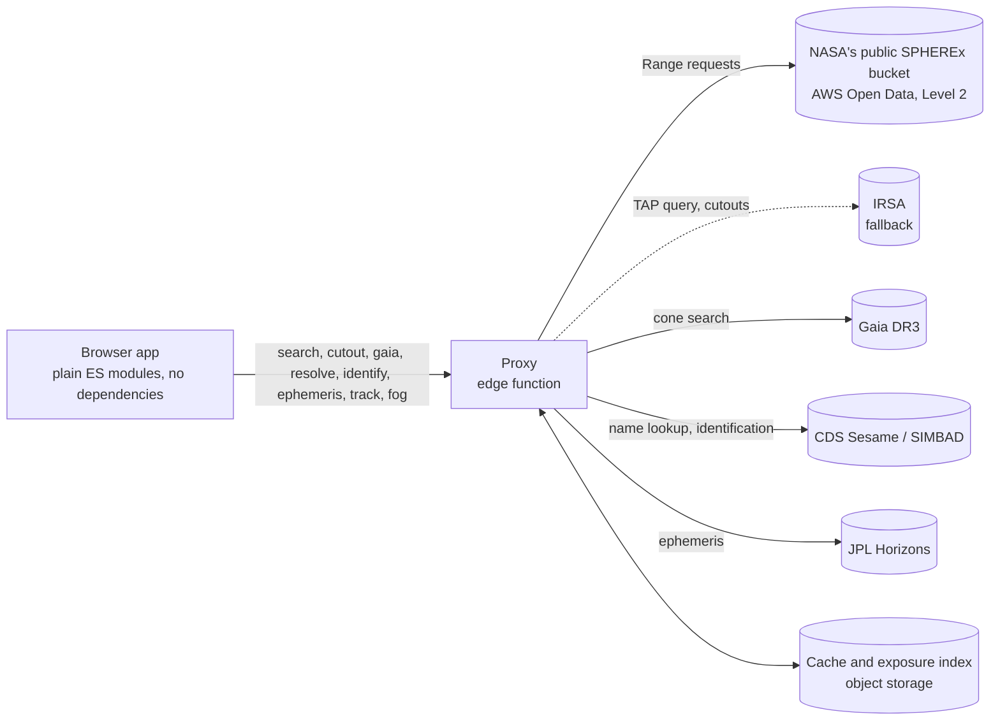

- **Why a proxy.** A full Level 2 file is about 65 MB. The page needs a small window of four
  layers and a wavelength for each pixel.
- **What the proxy does.** It answers "which exposures cover this position" from this project's
  own index of the bucket (272,963 exposures in 273 index units). It reads only the rows it needs
  from each file with HTTP Range requests, adds a wavelength for every pixel, and returns one
  small binary frame (about 72 kB for a 59 x 59 pixel cutout). Results are cached. If the bucket
  or the index cannot answer, it falls back to IRSA's search and cutout services. It also serves
  Gaia DR3 stars, name lookups, SIMBAD identifications and JPL Horizons ephemerides.
- **What the browser does.** Everything else: world coordinates (TAN with SIP distortion),
  resampling onto a common north-up grid, stacking, the per-pixel spectral fit, residuals,
  photometry, centroids, proper-motion fits, parallax geometry, rendering on canvas and SVG.

Details: [docs/ARCHITECTURE.md](docs/ARCHITECTURE.md).

```
proxy/src/        FITS reader, wavelength table, frame encoder, bucket client, exposure index,
                  IRSA client, Gaia, name resolver, Horizons, cache, HTTP handler, fog
proxy/fixtures/   synthetic SPHEREx-style files and a deterministic fake sky for tests
proxy/supabase/   edge-function entry point
web/src/core/     science library: wcs, reproject, stack, skymodel, photometry, astrometry, lenses
web/src/render/   canvas viewer and colour maps
web/src/plots/    spectrum, light curve, motion meter (SVG)
web/src/ui/       landing page, explainers, controls
web/src/fog/      HEALPix and the fog-of-war map
web/src/plugins/  datasource, export, identify, sonify, inject, validate, moving, story
web/src/local/    practice sky and browser-side data modes
clients/python/   a small Python reader for the frame format
tools/            single-file bundler, header check, deploy bundle, Astropy cross-check
docs/             results, science, architecture, sources, AI use, submission text
```

## Running locally

Requires Node 22 or later. There is nothing to install.

```sh
git clone https://github.com/IshiakiZ/Batchly-Public.git
cd Batchly-Public
git checkout claude/tombaugh
cd apps/tombaugh

node proxy/dev-server.mjs
# serves the page at http://localhost:8787/ and the API at /api/*,
# using a synthetic sky (one fast mover, one variable star, one methane-like absorber)

TOMBAUGH_BACKEND=s3 node proxy/dev-server.mjs
# live data from NASA's public bucket; the local index starts empty,
# so searches fall back to IRSA until it is built

TOMBAUGH_BACKEND=irsa node proxy/dev-server.mjs
# live data through IRSA's services only

node --test
# 997 unit tests; they do not touch the network

node tools/build.mjs
# writes dist/tombaugh.html, the whole app in one file
```

`test/e2e.mjs` drives the page in a real browser with Playwright (12 checks pass on the bundled
page). Playwright is a development tool and is not needed to run or build Tombaugh.

## Deploying

**Proxy.** The entry point is in `proxy/supabase/functions/spherex/`. It wraps the same handler the
dev server uses. The steps are in that folder's README; `node tools/deploy-bundle.mjs` checks and
assembles the files to upload.

```sh
supabase functions deploy spherex --no-verify-jwt
```

The function must be callable without a key, because the page calls it from any visitor's browser.
It keeps its cache and the exposure index in a private storage bucket named `spherex-cache`, which
it reaches with the `SUPABASE_URL` and `SUPABASE_SERVICE_ROLE_KEY` environment variables. Without
them it falls back to a small memory cache. Production base URL:
`https://api.batch-ly.com/functions/v1/spherex`.

**Page.** `node tools/build.mjs` produces `dist/tombaugh.html`. Host that one file anywhere that
serves static files. It finds the proxy from `window.TOMBAUGH_API`, then the `api` query parameter,
then `/api` on localhost, then the production URL above.

## Data and credits

- **SPHEREx Level 2 spectral images**, NASA/IPAC Infrared Science Archive, read from NASA's public
  SPHEREx bucket on AWS Open Data. Data Release 1 spectral images DOI 10.26131/IRSA678; Quick
  Release 3 DOI 10.26131/IRSA662. <https://irsa.ipac.caltech.edu/Missions/spherex.html>
- **Gaia DR3** positions, proper motions and parallaxes. ESA/Gaia/DPAC.
- **JPL Horizons** ephemerides of solar-system bodies. NASA/JPL.
- **CDS Sesame / SIMBAD** for name resolution and identification.
- **WiseView** (Backyard Worlds: Planet 9) as the model for a blink tool, and as the link target for
  WISE epochs.

Each view carries a citation line naming the releases shown, their DOIs and the retrieval date. The
complete list, with papers and standards, is in [docs/SOURCES.md](docs/SOURCES.md).

## Limits

- **Pixels are 6.15 arcseconds.** Motion smaller than about a pixel shows as a subtle bright-dark
  pair in the residual, not as a visible jump. Motions under about 1 arcsec/yr cannot be seen with
  this pixel size and this time span.
- **Three or four survey passes per target so far.** That makes a short track. The error on a
  single target's motion is 0.6 to 2.4 arcsec/yr, and parallax is not detected on its own.
- **Saturated stars.** Barnard's Star and R Draconis saturate the detector. Their positions and
  brightness ratios come from the unsaturated light around the core and are less certain than the
  formal error.
- **WISE 0855 is near the single-frame detection limit** (median signal-to-noise 4.7 per
  exposure). Its motion was measured from three passes in detector 6.
- **A real Planet X is probably too faint for SPHEREx.** Tombaugh is a tool for looking, and for
  the bright, nearby, fast things SPHEREx can see. No new object is claimed. The blind search was
  checked on nine control fields, and the injection test puts a Neptune-size planet at 500 AU
  about twice too faint for a typical patch; a real search needs many fields and a human to look
  at each candidate.
- **The residual method assumes a smooth spectrum within one detector.** Sharp spectral features,
  very bright stars and crowded fields leave residuals that are not change.
- **Fog of war counts views through Tombaugh only.** It says nothing about who has looked with
  other tools.

More in [docs/SCIENCE.md](docs/SCIENCE.md#limits-and-failure-modes) and
[docs/RESULTS.md](docs/RESULTS.md#8-what-these-results-do-not-show).

## Use of AI

The idea and its five parts are Pearce Harshbarger's, set down in their design note "Tombaugh: a
blink comparator for the 102-color sky" (13 November 2026). All code in this repository was written
by Claude (an AI model made by Anthropic, used through Claude Code) under
their direction, and every source file says so in its header. AI also helped research public
documentation and draft these documents. No AI-generated images or video are used. The full log is
in [docs/AI-USE.md](docs/AI-USE.md).

## Documents

| File | What is in it |
|---|---|
| [docs/RESULTS.md](docs/RESULTS.md) | Every number measured on real SPHEREx data, with controls and limits |
| [docs/SCIENCE.md](docs/SCIENCE.md) | Method, noise model, validation, failure modes |
| [docs/ARCHITECTURE.md](docs/ARCHITECTURE.md) | Components, data flow, frame format, caching, security |
| [docs/CROSSCHECK.md](docs/CROSSCHECK.md) | The code checked number by number against Astropy |
| [docs/SOURCES.md](docs/SOURCES.md) | Every data source, service, standard and paper |
| [docs/AI-USE.md](docs/AI-USE.md) | What AI did and what the human did |
| [docs/JUDGING-MAP.md](docs/JUDGING-MAP.md) | Judging criteria and challenge items mapped to features |
| [docs/SUBMISSION.md](docs/SUBMISSION.md) | Text for the submission form and a checklist |
| [docs/DEMO-SCRIPT.md](docs/DEMO-SCRIPT.md) | 30-second demo script and a seven-slide alternative |
| [CONTRACT.md](CONTRACT.md), [CONTRACT-S3.md](CONTRACT-S3.md), [CONTRACT-PLUGINS.md](CONTRACT-PLUGINS.md) | Module interfaces and verified facts about the data |

## License

Apache License 2.0. Copyright 2026 Pearce Harshbarger (Missing Mass). See [LICENSE](LICENSE) and
[NOTICE](NOTICE).
