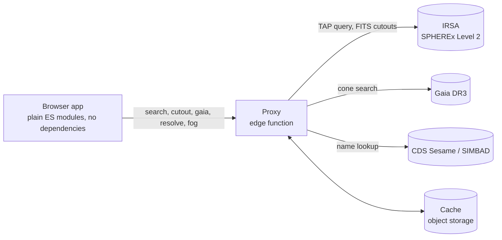

# Tombaugh

**A blink comparator for the 102-color sky.**

Tombaugh is a web tool that plays SPHEREx infrared images of any patch of sky as a short movie, so
that things which move or change brightness stand out. Because SPHEREx sees a patch at a different
wavelength in every exposure, Tombaugh predicts what the unchanging sky should look like in each
frame and shows what is left over.

Built by team Missing Mass for the NASA Space Apps Challenge 2026, challenge "Planet X and
SPHEREx". Not affiliated with or endorsed by NASA.

The name: Clyde Tombaugh found Pluto in 1930 by flipping between two photographic plates of the
same star field in a blink comparator and watching for the dot that jumped. The search he was
hired for was called Planet X.

> **Status.** The code is written and tested against a synthetic sky. The checks on real SPHEREx
> data are listed in [docs/SCIENCE.md](docs/SCIENCE.md) with placeholders for the measured numbers.
> Nothing in this repository reports a measurement that has not been made.

## Try it

Live tool: **[LIVE-URL]**

Type a position (`269.45 4.69`, `17h57m48.5s +04d41m36s`, `17:57:48.5 +04:41:36`) or a name
(`Barnard's Star`), or take the five-target tour from the first screen.

Every view is a link. The state of the page lives in the URL, so a link reproduces what you see and
can be embedded in another page.

| Parameter | Values | Default | Meaning |
|---|---|---|---|
| `ra`, `dec` | decimal degrees (ICRS) | none | Centre of the patch |
| `name` | text | none | Object name, resolved by the proxy: the five challenge targets from a built-in table, anything else through CDS Sesame, then SIMBAD |
| `fov` | `2`, `4`, `6`, `10` | `4` | Field of view in arcminutes |
| `det` | `1` to `6` | `3` | SPHEREx detector (D1 0.75-1.09, D2 1.10-1.62, D3 1.63-2.41, D4 2.42-3.82, D5 3.83-4.41, D6 4.42-5.00 um) |
| `view` | `passes`, `exposures`, `matched`, `residual`, `diff`, `lens`, `distance` | `passes` | What to show (see below) |
| `ch` | `0` to `16` | `8` | Spectral channel within the detector, for `matched` |
| `lens` | `methane`, `water`, `co2`, `co`, `rgb` | `methane` | Molecule lens, for `view=lens` |
| `dist` | astronomical units, or `inf` | `inf` | Distance assumed by the distance dial, for `view=distance` |
| `t` | frame index | `0` | Which frame of the movie is showing |
| `stretch` | `asinh`, `linear`, `log`, `sqrt` | `asinh` | Brightness scaling |
| `gaia` | `0`, `1` | `1` | Gaia DR3 rings on or off |
| `flags` | `0`, `1` | `0` | Pixel-flag overlay on or off |
| `embed` | `1` | off | Hide the page chrome, for iframes |
| `api` | URL | production proxy | Use a different proxy (development) |

Examples:

```
[LIVE-URL]?name=Barnard%27s%20Star&view=residual&det=3&gaia=1
[LIVE-URL]?ra=133.795129&dec=-7.245147&fov=4&det=6&view=passes
```

The second is the challenge's position for WISE 0855, 08h55m10.831s -7d14m42.53s, in degrees. That
position is for about 2014 (verify). The object has moved about 1.6 arcminutes west since, which
is why the tour centres on its position today and why a link by `name` is the better one to share.

Embedding:

```html
<iframe src="[LIVE-URL]?name=Barnard%27s%20Star&view=passes&embed=1"
        width="480" height="560" style="border:0" title="Tombaugh: Barnard's Star"></iframe>
```

Keyboard: space play/pause, arrows step, `b` blink, `r` residual, `g` Gaia, `f` flags, `1`-`6`
detector, `?` help.

## The idea

SPHEREx has no filter wheel. A linear variable filter sits above each of its six detectors, so the
wavelength a pixel sees depends on where the pixel is on the detector. The telescope steps across
the sky and each patch slides down the filter, exposure by exposure. That is how it builds a
102-band spectrum of everything. It also means that **SPHEREx never photographs a patch in the same
colour twice.**

Two consequences for anyone who wants a blink movie:

1. Play the exposures in time order and every star changes brightness from frame to frame, because
   the colour changed, not the star. The movie flickers and the flicker hides real change.
2. A SPHEREx pixel is 6.15 arcseconds across. Barnard's Star, the star with the largest known proper
   motion, moves 10.4 arcseconds a year, about 5 arcseconds between two survey passes. That is
   less than one pixel. Blinking alone will not show it.

```
One pixel of sky, one detector, all its exposures:

  exposure      1       2       3     ...    41      42    ...
  pass        2025-06 2025-06 2025-06      2025-12 2025-12
  wavelength   1.61    1.52    1.31         1.58    1.24   (um, illustrative)

  Naive blink: 1 -> 2 -> 3 ...   brightness jumps because the wavelength jumped.

  Predicted-sky subtraction:

  brightness
      |                  X
      |     o
      |  o .-''''-. o             o  one exposure of this pixel
      |  .'        '-.  o         -  smooth curve fitted through all exposures
      | '    o        '-.         X  an exposure the curve cannot explain
      +------------------------------> ln(wavelength)

  residual(frame) = image(frame) - curve(wavelength of each pixel in that frame)
```

What Tombaugh does instead:

- **Passes.** Group the exposures into survey passes (about six months apart), stack each pass per
  detector, and blink the stacks. Colour averages out; position does not.
- **Predicted-sky subtraction.** For every pixel, fit a smooth spectrum through all exposures of
  one detector. For each frame, predict what the static sky would look like at exactly the
  wavelengths that frame saw, and subtract. A star that stayed put and stayed the same cancels. A
  star that moved leaves a bright-dark pair. A star that varied leaves a pulse.
- **Measure.** Centroid the object in each pass, fit a proper motion, and put the number beside the
  one Gaia measured. That comparison is the tool's check on itself.

The method, its noise model and its failure modes are in [docs/SCIENCE.md](docs/SCIENCE.md).

## What it does, mapped to the challenge

### Objectives

| Challenge asks for | Tombaugh | Where |
|---|---|---|
| A public-facing web tool | One page, no account, no install | [LIVE-URL] |
| Enter RA and Dec | Decimal or sexagesimal coordinates, or a name | Search box; `ra`, `dec`, `name` |
| A series of SPHEREx images of that patch, like a little video | Time-ordered movie of every exposure; movie of per-pass stacks; play, pause, speed, step, blink A/B | `view=exposures`, `view=passes` |
| Easy to spot moving objects | Residual movie with a list of candidate changes; Gaia rings that a moving star leaves behind; a motion meter compared with Gaia | `view=residual`, `gaia=1` |
| Test on Barnard's Star, Epsilon Indi B, WISE 0855, RW Aurigae, R Draconis | Five-target tour on the first screen | Landing page |

### Optional considerations

| Consideration | Tombaugh | Where |
|---|---|---|
| Easy to update with new releases | Frames are found by a live archive query; the release name is read from each file path. New data appear without a code change | [docs/ARCHITECTURE.md](docs/ARCHITECTURE.md) |
| Creative display of the 102 bands; add each of the six detector arrays for signal-to-noise | Per-pass stacks for each detector; wavelength-matched channel view (the same channel across passes); molecule lenses; three-detector colour | `view=passes`, `view=matched`, `view=lens` |
| Spectra on the fly | Click any position for an aperture spectrum across all loaded frames, and a light curve; export as CSV | Click in the viewer |
| Add or subtract images taken at different times | Add or subtract any two passes | `view=diff` |
| User-chosen field of view | 2, 4, 6 or 10 arcminutes | `fov` |
| Overlays from Gaia or WISE | Gaia DR3 rings at catalogue positions, with proper motion. WISE is not overlaid; the tool links to WiseView at the same coordinates | `gaia=1`; WiseView link |
| Coordinates in the URL, embeddable | Full view state in the URL; chrome-free embed mode | `embed=1` |
| Metadata such as contamination flags | Flag overlay with named bits per pixel; frame date, wavelength, observation id and release in the caption; photometry reports when flagged pixels fall in the aperture | `flags=1` |
| Reuse of public tools such as Astropy and Aladin | Reuses public services and standards (IRSA TAP and cutouts, Gaia DR3, CDS Sesame, FITS WCS, SIP, HEALPix) and follows WiseView's design. Astropy and Aladin are not bundled; the page has no dependencies so it can ship as one file | [docs/SOURCES.md](docs/SOURCES.md) |

### Beyond the brief

- **Molecule lenses.** Colour the field by the depth of an absorption band: methane (3.3 um), water
  ice (3.05 um), CO2 (4.27 um), CO (4.67 um). Cold brown dwarfs are dark in methane.
- **Distance dial.** Choose a distance in AU. Tombaugh shifts each frame by the parallax a body at
  that distance would show and stacks. A body at that distance adds up; everything else smears.
  At 500 AU the shift between two passes is 13.75 arcminutes.
- **Fog of war.** An all-sky map, dark wherever nobody has yet opened a patch in Tombaugh, with a
  button that takes you somewhere nobody has looked.

Not built: the 16-year movie that would splice SPHEREx onto WISE epochs. The tool links to WiseView
instead.

## How it works



- **Why a proxy.** IRSA sends no CORS headers, so a browser cannot call it directly. Each cutout is
  a 4.0 MB FITS file whatever its size on the sky, because a PSF table dominates it.
- **What the proxy does.** It runs the archive search, starts each cutout download and stops
  reading when the PSF table begins, keeps the image, flags, variance and zodiacal-light layers,
  adds a wavelength for every pixel, and returns one small binary frame (about 72 kB for a
  59 x 59 pixel cutout). Results are cached. It also serves Gaia DR3 stars and name lookups.
- **What the browser does.** Everything else: world coordinates (TAN with SIP distortion),
  resampling onto a common north-up grid, stacking, the per-pixel spectral fit, residuals,
  photometry, centroids, proper-motion fits, parallax geometry, rendering on canvas and SVG.

Details: [docs/ARCHITECTURE.md](docs/ARCHITECTURE.md).

```
proxy/src/        FITS reader, wavelength table, frame encoder, IRSA client, cache, HTTP handler, fog
proxy/fixtures/   synthetic SPHEREx-style files and a deterministic fake sky for tests
proxy/supabase/   edge-function entry point
web/src/core/     science library: wcs, reproject, stack, skymodel, photometry, astrometry, lenses
web/src/render/   canvas viewer and colour maps
web/src/plots/    spectrum, light curve, motion meter (SVG)
web/src/ui/       landing page, explainers, controls
web/src/fog/      HEALPix and the fog-of-war map
tools/build.mjs   single-file bundler
docs/             science, architecture, sources, AI use, submission text
```

## Running locally

Requires Node 22 or later. There is nothing to install.

```sh
git clone [REPO-URL]
cd tombaugh

node proxy/dev-server.mjs
# serves the page at http://localhost:8787/ and the API at /api/*,
# using a synthetic sky (one fast mover, one variable star, one methane-like absorber)

TOMBAUGH_BACKEND=irsa node proxy/dev-server.mjs
# the same, against the live IRSA archive

node --test
# unit tests; they do not touch the network

node tools/build.mjs
# writes dist/tombaugh.html, the whole app in one file
```

`test/e2e.mjs` drives the page in a real browser with Playwright. Playwright is a development tool
and is not needed to run or build Tombaugh.

## Deploying

**Proxy.** The entry point is in `proxy/supabase/functions/spherex/`. It wraps the same handler the
dev server uses.

```sh
supabase functions deploy spherex --no-verify-jwt   # (verify flags against the function's config)
```

The function must be callable without a key, because the page calls it from any visitor's browser.
It needs a storage bucket for its cache and the project URL and service key to reach it; see the
entry point for the variable names (verify). Production base URL:
`https://api.batch-ly.com/functions/v1/spherex`.

**Page.** `node tools/build.mjs` produces `dist/tombaugh.html`. Host that one file anywhere that
serves static files. It finds the proxy from `window.TOMBAUGH_API`, then the `api` query parameter,
then `/api` on localhost, then the production URL above.

## Data and credits

- **SPHEREx Level 2 spectral images**, NASA/IPAC Infrared Science Archive. Mission archive DOI
  10.26131/IRSA629 (verify); Quick Release 3 DOI 10.26131/IRSA662 (verify); Data Release 1 DOI
  [DR1-DOI] (verify). <https://irsa.ipac.caltech.edu/Missions/spherex.html>
- **Gaia DR3** positions, proper motions and parallaxes. ESA/Gaia/DPAC.
- **CDS Sesame / SIMBAD** for name resolution.
- **WiseView** (Backyard Worlds: Planet 9) as the model for a blink tool, and as the link target for
  WISE epochs.

Each view carries a citation line naming the releases shown and the retrieval date. The complete
list, with papers and standards, is in [docs/SOURCES.md](docs/SOURCES.md) and [NOTICE](NOTICE).

## Limits

- **Pixels are 6.15 arcseconds.** Motion smaller than about a pixel shows as a subtle bright-dark
  pair in the residual, not as a visible jump.
- **About three survey passes exist so far.** Three points make a short track. Proper-motion errors
  are large and parallax is hard to separate from motion.
- **WISE 0855 is near the single-frame detection limit.** Expect it in stacks, if at all, and only
  in the longest-wavelength detectors.
- **A real Planet X is probably too faint for SPHEREx.** Tombaugh is a tool for looking, and for
  the bright, nearby, fast things SPHEREx can see. The distance dial is demonstrated on a known
  body or on a synthetic source injected into real frames.
- **The residual method assumes a smooth spectrum within one detector.** Sharp spectral features,
  very bright or saturated stars, and crowded fields leave residuals that are not change.
- **Fog of war counts views through Tombaugh only.** It says nothing about who has looked with
  other tools.

More in [docs/SCIENCE.md](docs/SCIENCE.md#limits-and-failure-modes).

## Use of AI

The idea and its five parts are Pearce Harshbarger's, set down in their design note "Tombaugh: a
blink comparator for the 102-color sky" (13 November 2026). All code in this repository was written
by Claude (an AI model made by Anthropic; model "Claude Fable 5.2", used through Claude Code) under
their direction, and every source file says so in its header. AI also helped research public
documentation and draft these documents. No AI-generated images or video are used. The full log is
in [docs/AI-USE.md](docs/AI-USE.md).

## Documents

| File | What is in it |
|---|---|
| [docs/SCIENCE.md](docs/SCIENCE.md) | Method, noise model, validation plan, failure modes |
| [docs/ARCHITECTURE.md](docs/ARCHITECTURE.md) | Components, data flow, frame format, caching, security |
| [docs/SOURCES.md](docs/SOURCES.md) | Every data source, service, standard and paper |
| [docs/AI-USE.md](docs/AI-USE.md) | What AI did and what the human did |
| [docs/JUDGING-MAP.md](docs/JUDGING-MAP.md) | Judging criteria and challenge items mapped to features |
| [docs/SUBMISSION.md](docs/SUBMISSION.md) | Text for the submission form and a checklist |
| [docs/DEMO-SCRIPT.md](docs/DEMO-SCRIPT.md) | 30-second demo script and a seven-slide alternative |
| [CONTRACT.md](CONTRACT.md) | Module interfaces and verified facts about the data |

## License

Apache License 2.0. Copyright 2026 Pearce Harshbarger (Missing Mass). See [LICENSE](LICENSE) and
[NOTICE](NOTICE).
