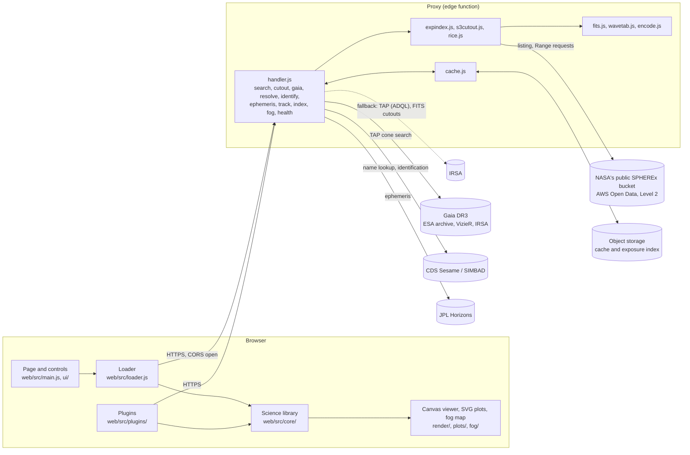

# Tombaugh: architecture

Two parts. A small proxy finds and trims data from public archives. A browser app does the
science and the drawing. Neither has a third-party dependency.

The proxy reads NASA's public SPHEREx bucket on AWS Open Data, using this project's own index of
every exposure in it (272,963 exposures in 273 index units). IRSA's search and cutout services
are the fallback. The reason is in [CONTRACT-S3.md](../CONTRACT-S3.md): on the night of 14 to 15
November 2026 IRSA's search answered with gateway errors for hours.



## Components

### Proxy (`proxy/`)

Pure JavaScript using only Web-standard APIs (`fetch`, streams, typed arrays, `crypto.subtle`), so
the same modules run in Node (dev server, tests) and in Deno (the deployed edge function).

| Module | Job |
|---|---|
| `src/fits.js` | Minimal FITS reader: header blocks, multi-extension layout, big-endian images, the WCS-WAVE binary table. `readUntilPsf` reads a download stream only until the PSF table's header appears, then cancels it |
| `src/wavetab.js` | Bilinear lookup in the 11 x 11 wavelength table; wavelength map for a cutout |
| `src/encode.js` | Builds and decodes TBF1 frames |
| `src/s3.js` | Client for the public bucket: listing, Range requests, key and id validation |
| `src/expindex.js` | The exposure index: built from FITS headers in the bucket, searched for a fixed position or along a moving body's track |
| `src/focalplane.js` | Approximate pointing of detectors 2 to 6 from detector 1, so one header per exposure is enough for the index |
| `src/s3cutout.js` | Cuts the needed rows out of a full 65 MB file with 8 Range requests |
| `src/rice.js` | Decompresses the tile-compressed FLAGS layer (RICE_1) |
| `src/irsa.js` | IRSA client, the fallback: frame search over TAP, cutout download, wavelength-table download, input validation |
| `src/gaia.js` | Gaia DR3 cone search |
| `src/resolve.js` | Name resolver: built-in table of the challenge targets, CDS Sesame, SIMBAD |
| `src/identify.js` | Catalogued objects near a position, from SIMBAD |
| `src/horizons.js` | Ephemerides of solar-system bodies from JPL Horizons |
| `src/cache.js` | In-memory LRU cache and a storage-bucket cache with the same interface |
| `src/fog.js` | Fog-of-war counters |
| `src/handler.js` | Routes requests, validates input, applies caching, shapes errors |
| `fixtures/synth.js` | Byte-accurate synthetic SPHEREx-style files and a deterministic fake sky |
| `dev-server.mjs` | Serves `web/` and the API on `http://localhost:8787/` |
| `supabase/functions/spherex/` | Edge-function entry point wrapping the same handler |

### Browser app (`web/`)

Plain ES modules, loaded directly in development and inlined into one HTML file for release.

| Module | Job |
|---|---|
| `src/api.js` | Client for the proxy; decodes TBF1 into a `Frame` |
| `src/state.js` | Observable store; reads and writes the URL |
| `src/loader.js` | One search, then cutouts with a concurrency of 6 and two retries each; resamples each frame as it arrives so the movie can start before the download ends |
| `src/core/` | Science library: WCS, resampling, stretch, time, flags, passes and channels, stacking, sky model, photometry, lenses, astrometry, ephemeris, distance dial, targets. No DOM; runs in Node for tests |
| `src/render/` | Canvas viewer (north up, east left), colour maps, overlays |
| `src/plots/` | Spectrum, light curve and motion meter in SVG |
| `src/fog/` | HEALPix (nested, nside 32) and the all-sky Mollweide map |
| `src/ui/` | Landing page, explainers, shortcuts, animation helpers |
| `src/plugins/` | Self-contained extras, each loaded with one line and skipped if it fails (see below and [CONTRACT-PLUGINS.md](../CONTRACT-PLUGINS.md)) |
| `src/local/` | Browser-side data modes: a simulated practice sky, and a direct read of the bucket by the browser. The direct mode was not verified against the real services ([DEVIATIONS.md](DEVIATIONS.md)) |

Plugins (`web/src/plugins/`):

| Plugin | Name in the page | Job |
|---|---|---|
| `datasource` | Data source | Says where the images on screen come from and lets the user change it; everything simulated is marked SIMULATED |
| `export` | Export | Saves a frame (PNG), a share card, the movie as GIF or WebM, a link, or the clicked source as CSV |
| `identify` | What is this? | For a clicked source: what SIMBAD lists there, the nearest Gaia star, and what the SPHEREx measurements suggest, marked as automated hints |
| `sonify` | Listen | Plays the spectrum and the light curve of the selected source as sound, with a text description |
| `inject` | Injection test | Plants a simulated body in copies of the real frames and reports whether the tool's own pipeline finds it |
| `validate` | Validation | Measures the loaded field, or the five challenge targets in one run, against catalogues with field-star controls, and exports a report |
| `moving` | Solar system; view "Follow body" | Follows a solar-system body through the exposures that caught it and stacks them in its frame (`?body=pluto`) |
| `story` | Tour | Guided stories: a tour of the controls and a short story per challenge target |

The **Candidates** tab is part of the core, not a plugin: `findCandidates` in
`core/skymodel.js` lists what is left after the predicted sky is subtracted. A saturated star is
found first (`saturatedCores`) and reported as one candidate that moved, brightened or faded
(`haloChange`).

The page runs inside a sandboxed iframe with an opaque origin: storage, history and clipboard
calls are wrapped, and it uses no cookies.

## Data flow for one target

1. **Position.** The page reads `ra`, `dec` or `name` from the URL or the search box. A name goes
   to `GET /resolve`, which looks in a small built-in table of the five challenge targets, then
   asks CDS Sesame, then SIMBAD, and returns coordinates with their epoch and, where known, proper
   motion and parallax. A target with a known proper motion is moved to today's date before the
   patch is requested: WISE 0855 is more than 2 arcminutes from the position in the challenge
   statement.
2. **Search.** `GET /search?ra&dec`. The proxy answers from its exposure index. It keeps the week
   directories whose coverage bitmap includes the position, and for every exposure and detector
   projects the position into detector pixels with an approximate WCS. An exposure is returned
   when the position falls on the detector with a margin of 16 pixels. The answer lists file path
   (`id`), detector, MJD, release and observation id, sorted by time. A detector with more than
   200 exposures is thinned evenly and the answer says how many there were. If the index cannot
   answer, the proxy runs one ADQL query on IRSA's TAP service.
3. **Cutouts.** The loader requests `GET /cutout?id&ra&dec&size` for each frame of the chosen
   detector, six at a time. For each one the proxy:
   - checks its cache;
   - otherwise reads the file in the bucket with 8 Range requests: the headers, then only the
     rows of the IMAGE, FLAGS, VARIANCE and ZODI layers that cover the cutout. The FLAGS rows are
     tile-compressed and are decompressed in the proxy. The exact header of the file is always
     used for the science; the approximate WCS is only for the search;
   - looks up the wavelength table for that detector. It sits in the last 5760 bytes of every
     file and is identical in every file of a detector, so it is fetched once and cached;
   - computes a wavelength for every pixel of the cutout;
   - encodes a TBF1 frame, caches it and returns it.
   If the bucket fails, the proxy asks IRSA's cutout service for the same file and stops reading
   when the PSF table begins.
4. **Resampling.** The browser decodes each frame and resamples it onto the session's north-up
   grid (`core/reproject.js`). The movie can play as frames arrive.
5. **Science.** Passes are split, stacks made, the per-pixel sky model fitted, residuals, the
   change map and the candidate list computed, all in the browser (`core/`). See
   [SCIENCE.md](SCIENCE.md).
6. **Overlays.** `GET /gaia?ra&dec&radius` returns Gaia DR3 stars for the rings and for the
   proper-motion comparison.
7. **Fog.** `POST /fog?ra&dec` increments the visit count of the HEALPix cell; `GET /fog` returns
   all counts for the map.

**A moving body** (`?body=pluto`). `GET /ephemeris?body` forwards one request to JPL Horizons and
returns where the body was at regular times. `POST /track` gives those samples to the exposure
index, which returns every exposure that caught the body, each with the body's position at that
moment. The page then requests a cutout centred on the body for each, at most 360 exposures, and
stacks them in the body's frame.

## HTTP API

Base URL in production: `https://api.batch-ly.com/functions/v1/spherex`. In development: `/api`.
Every response carries `Access-Control-Allow-Origin: *`. Errors are JSON,
`{ "error": "<message>", "retryable": true|false }`, with a 4xx or 5xx status.

| Route | Returns |
|---|---|
| `GET /search?ra=<deg>&dec=<deg>` | `{ ra, dec, cached, fetchedAt, source, complete, counts, frames: [{ id, det, mjd, release, obsid }] }`. `source` is `index` or `irsa-tap` |
| `GET /cutout?id=<uri>&ra=<deg>&dec=<deg>&size=<deg>` | One TBF1 frame (`application/octet-stream`). `size` is clamped to 0.02 - 0.2 deg |
| `GET /gaia?ra=<deg>&dec=<deg>&radius=<deg>` | `{ epoch: 2016.0, stars: [{ id, ra, dec, pmra, pmdec, parallax, gmag }] }`. Radius clamped to 0.25 deg, at most 500 stars, brightest first |
| `GET /resolve?name=<text>` | `{ name, ra, dec, epoch, pmra, pmdec, parallax, source }`, or 404 |
| `GET /identify?ra=<deg>&dec=<deg>&radius=<deg>` | `{ objects: [...], source: "simbad" }`: catalogued objects near a position |
| `GET /ephemeris?body=<name>&start=<mjd>&end=<mjd>&step=<hours>` | `{ body, name, source: "JPL Horizons", center: "geocentric", samples: [[mjd, ra, dec, deltaAU, mag]] }` |
| `POST /track` with `{ samples: [[mjd, ra, dec], ...] }` | `{ frames: [{ id, det, mjd, ra, dec, ... }] }`: exposures that caught a moving body |
| `GET /index` | Status of the exposure index: directories and exposures done. `POST /index?op=build` builds the next missing piece; every operation is bounded and repeatable |
| `GET /fog` | 24,576 bytes: `Uint16Array(12288)` little-endian visit counts |
| `POST /fog?ra=<deg>&dec=<deg>` | `{ cell, count }` |
| `GET /health` | `{ ok, version, irsa: "up" | "down" | "unknown", backend }` |

The full specification is in [CONTRACT.md](../CONTRACT.md), [CONTRACT-S3.md](../CONTRACT-S3.md)
and the header comments of `proxy/src/handler.js`.

## The TBF1 frame format

A full Level 2 file is about 65 MB, and a cutout from IRSA's service is about 4.0 MB whatever its
size on the sky. TBF1 carries only what the browser needs. For a 59 x 59 pixel cutout it is about
72 kB.

```
bytes 0..3     ASCII "TBF1"
bytes 4..7     uint32 little-endian: N, the byte length of the JSON header
               (space-padded so that 8 + N is a multiple of 8)
bytes 8..8+N   UTF-8 JSON header
then           raw little-endian arrays at the offsets listed in header.arrays
```

The JSON header holds the file identity (`id`, `release`, `obsid`, pipeline `version`), the
detector, array size, time (`mjd` from `MJD-AVG`), exposure time, units, PSF width, the full WCS
(reference pixel, reference value, PC matrix and every SIP coefficient), the detector pixel of the
cutout corner, the wavelength and bandwidth at the centre, and a list of arrays:

| Array | Type | Content |
|---|---|---|
| `image` | float32 | Surface brightness, MJy/sr |
| `variance` | float32 | Variance, MJy2/sr2 |
| `zodi` | float32 | Zodiacal light model, MJy/sr |
| `flags` | int32 | Pixel flag bits |
| `wave` | float32 | Wavelength of every pixel, um |

Arrays are row-major, the same shape as the image, at offsets that are multiples of 4 so they can
be viewed in place as typed arrays. The format is versioned (`"v": 1`). The same `decodeFrame`
exists on both sides and the round trip is unit-tested.

Why a custom format and not FITS: a browser would need a FITS reader and a `-TAB` lookup to do
anything with the original, and the wavelength table is at the far end of the file. Trimming on
the server and sending little-endian arrays removes both costs.

## Caching

The proxy has one cache interface with two implementations: an in-memory LRU for development and
tests, and a private object-storage bucket in production. A cache failure is treated as a miss
and never fails a request.

| What | Key | Lifetime |
|---|---|---|
| Cutout frame | file path, position, size | Long. The file path contains the release and the pipeline version, so a reprocessed file has a new path and a cached frame never goes stale |
| Wavelength table | detector | Long. Identical across files of a detector |
| Exposure index | `index/v2/...`: a directory list, and per week directory and processing version a list, binary parts and a summary with a coverage bitmap; one manifest | Kept. The directory list is re-read from the bucket when it is older than 6 hours. A search from the index is computed on each request |
| Search result from IRSA (fallback) | position, rounded to 0.0001 deg | 12 hours, so that new observations appear; 10 minutes for an empty answer, which may be an archive hiccup. The response says whether it was `cached` and when it was `fetchedAt`. If IRSA fails, an expired answer is served and marked `stale` |
| Gaia cone, name lookup, identification | position and radius, name | 30 days. Gaia DR3 is a fixed catalogue |
| Fog counters | one object, `fog/nside32.bin` | Read, modify, write. A lost increment under a race is accepted |

Cache keys are a readable prefix plus a SHA-1 digest of the parts, so no user-supplied string
becomes a storage path.

The browser keeps decoded frames in memory per target, so changing the detector or the field of
view re-uses what it already has.

## When IRSA is slow or down

IRSA is now the fallback, used when the exposure index or the bucket cannot answer. Its TAP
search takes about 20 seconds on a good day and at times answers with a gateway error or hangs.
The fallback path assumes this.

- **Timeouts everywhere.** Every upstream request has its own timeout covering headers and body:
  75 s per search attempt, 40 s per cutout, 90 s for a wavelength table.
- **Retries with back-off** for failures that can recover (5xx, 408, 429, timeouts, network
  errors). Client errors are not retried.
- **Search fallback.** If the synchronous TAP query cannot finish, the search is handed to an
  asynchronous TAP job (UWS) that survives the proxy's own request being cut short, and a later
  request resumes it. The whole search is held to 130 s, inside the edge function's time limit.
- **Error pages are recognised.** A gateway error arrives as an HTML page, sometimes with status
  200. The proxy detects HTML or a VOTable error document where a table was expected and reports
  a retryable error with the upstream message.
- **Honest errors.** The proxy answers with `{ error, retryable }` and a status of 502, 504 or 404.
  The page shows the message and offers a retry when `retryable` is true.
- **Partial results.** The loader retries each cutout twice and then moves on. A movie with some
  frames missing still plays; the count of failed frames is shown.
- **Cache first.** Frames of a target that anyone has opened before load from the cache without
  touching the bucket or IRSA. If a search fails and an older answer exists, the older answer is served and
  marked stale. Opening the five challenge targets ahead of a demonstration puts them in the
  cache.
- **One request, not many.** Identical searches arriving together share one upstream query, and
  no more than 12 cutout downloads run against IRSA at once.
- **Built-in targets.** The five challenge targets resolve from a built-in table, so the tour
  works when CDS is unreachable.
- **Health.** `GET /health` reports whether IRSA is reachable, so the page can say that the
  archive is down instead of spinning.
- **Gaia** is asked of three services in turn: the ESA Gaia archive, VizieR at CDS, then IRSA's
  copy. If all three fail, the rings are omitted and everything else still works.
- **Bucket failures.** Range requests are retried. A cutout that still fails in the bucket is
  asked of IRSA's cutout service. Transient failures while the index is being built are retried,
  and a step with too many failures stores nothing, so an outage is not written into the index.
- **Offline development.** `node proxy/dev-server.mjs` uses a synthetic backend that needs no
  network. Tests never reach the network.

## Security of the proxy

The proxy is public and unauthenticated, so it must not be usable as a general relay.

- **Fixed upstream hosts.** The proxy only ever contacts the public bucket `nasa-irsa-spherex`,
  IRSA, the Gaia services, CDS and the JPL Horizons API. No parameter can change the host.
- **Strict `id` pattern.** The `id` of a cutout must be a SPHEREx Level 2 file path:
  `^ibe/data/spherex/[a-z0-9]+/level2/.+\.fits$`, built from the characters
  `A-Z a-z 0-9 _ - . /` only, at most 400 characters, with no `..` and no `//`. That excludes query
  strings, fragments, percent-escapes, other hosts and path traversal. Anything else is refused
  with a 400 before any request leaves the proxy.
- **Body names** for an ephemeris may contain letters, digits, spaces and `/ - = ;` only, at
  most 40 characters. A track may hold at most 6000 samples.
- **The index routes** are public. Every operation is bounded and repeatable, and its only
  upstream is the public bucket.
- **Async job URLs** returned by IRSA are accepted only if they are on the IRSA host under
  `/TAP/async/`.
- **Numeric inputs are validated and clamped.** RA 0 - 360, Dec -90 - 90, cutout size 0.02 - 0.2
  deg, Gaia radius at most 0.25 deg and 500 stars. Coordinates are written into queries as plain
  fixed-point numbers, never as raw text, so ADQL cannot be injected.
- **Size limits.** Upstream bodies are read with a byte cap (24 MB for a cutout, 48 MB for a
  table) and abandoned beyond it.
- **No secrets in the browser.** The storage key lives in the edge function's environment. The
  bucket is private.
- **No personal data.** There are no accounts, no cookies and no analytics. The fog-of-war
  counters store a number per sky cell and nothing about who looked.
- **Known weakness.** The fog counter can be incremented by anyone who calls `POST /fog`. It is a
  shared decoration, not a record, and is described that way.

The proxy bounds its own load upstream (12 concurrent cutout downloads, shared searches). Limiting
requests per visitor is left to the hosting platform; this repository configures none.

## New data releases without code changes

The bucket gains a new week directory as data are released: Data Release 1 has 110 of them and
Quick Release 3 has 41, about 3.5 days of observing each. Tombaugh has no list of files, weeks or
releases in its code.

- The index lists the bucket's directories itself and re-reads that list when it is older than
  6 hours. It uses every data release and only the newest quick release; when a week exists in
  both, the data release is used.
- A new directory is added by running the index build (`POST /index?op=build`), which reads one
  header per exposure. This is a bounded, repeatable step and needs no code change. Until a
  directory is indexed, its exposures do not appear.
- The release label (`qr3`, `dr1`, and whatever follows) is read from each file path, not from a
  table in the code.
- A reprocessed file has a new path, so it is fetched fresh and the old cached frame is simply
  never asked for again.
- The citation line under each view is built from the releases of the frames on screen. The DOIs
  are in one constant (`web/src/ui/citation.js`), so a new release needs one line for its DOI and
  nothing else.
- Passes are found from the gaps in time between exposures, so a fourth or a tenth pass needs no
  change.
- The wavelength table is read from the files. If a new release changes the wavelength
  calibration, the cached table for that detector must be cleared; the table is checked for
  structure when it is read.

## Build and deployment

- **Development.** `node proxy/dev-server.mjs`. Synthetic backend by default;
  `TOMBAUGH_BACKEND=s3` for the public bucket, `TOMBAUGH_BACKEND=irsa` for IRSA only.
- **Tests.** `node --test` runs the unit tests beside each module (997 pass). `test/e2e.mjs`
  drives the page in a browser with Playwright against the synthetic backend (12 checks pass on
  the bundled page). `tools/crosscheck/` compares the code with Astropy
  ([CROSSCHECK.md](CROSSCHECK.md)).
- **Bundle.** `node tools/build.mjs` inlines the modules, styles and markup into
  `dist/tombaugh.html`. One file, no build-time dependencies.
- **Proxy.** Deployed as a Supabase edge function named `spherex`, with the bucket backend. It
  keeps its cache and the index in a private storage bucket, `spherex-cache`, reached with the
  `SUPABASE_URL` and `SUPABASE_SERVICE_ROLE_KEY` environment variables. `tools/deploy-bundle.mjs`
  checks and assembles the files to upload.
- **Page.** Hosted at `https://batch-ly.com/tombaugh/index.html`: the single file from
  `node tools/build.mjs --strict --minify --banner --api https://api.batch-ly.com/functions/v1/spherex --out dist/live/index.html`,
  placed in the site's `public/tombaugh/` folder and uploaded by the site's own deploy script.
- **The site's security policy.** batch-ly.com sends a Content-Security-Policy header. The page
  was loaded under that policy in a test browser (15 November 2026): its inline script, styles,
  workers and images are all allowed, and so is the proxy at `api.batch-ly.com`. One thing is not:
  the policy's `connect-src` does not list `https://nasa-irsa-spherex.s3.amazonaws.com`, so the
  "Direct from NASA's public cloud copy" fallback is blocked on that address and the page stays on
  the proxy. The fallback works wherever the page is served without that policy (a local copy, the
  repository). Adding the bucket's address to `connect-src` would enable it on the site as well.
- **API base selection in the page.** `window.TOMBAUGH_API`, else the `api` query parameter, else
  `/api` on localhost, else the production URL.
