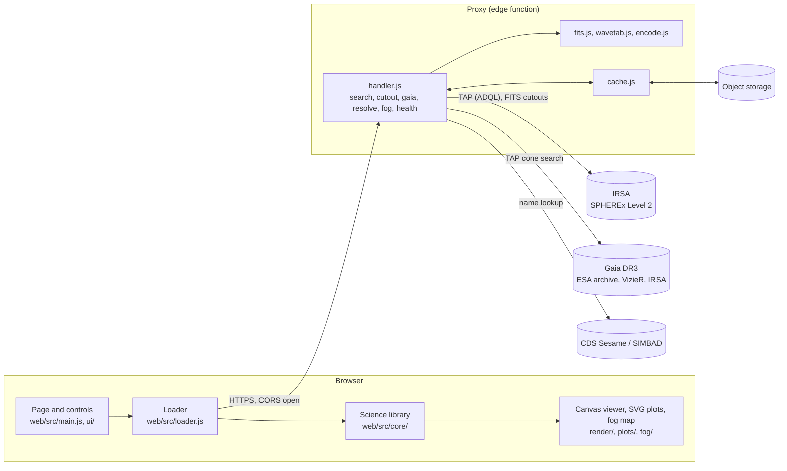

# Tombaugh: architecture

Two parts. A small proxy fetches and trims data from public archives. A browser app does the
science and the drawing. Neither has a third-party dependency.



## Components

### Proxy (`proxy/`)

Pure JavaScript using only Web-standard APIs (`fetch`, streams, typed arrays, `crypto.subtle`), so
the same modules run in Node (dev server, tests) and in Deno (the deployed edge function).

| Module | Job |
|---|---|
| `src/fits.js` | Minimal FITS reader: header blocks, multi-extension layout, big-endian images, the WCS-WAVE binary table. `readUntilPsf` reads a download stream only until the PSF table's header appears, then cancels it |
| `src/wavetab.js` | Bilinear lookup in the 11 x 11 wavelength table; wavelength map for a cutout |
| `src/encode.js` | Builds and decodes TBF1 frames |
| `src/irsa.js` | IRSA client: frame search over TAP, cutout download, wavelength-table download, input validation |
| `src/gaia.js` | Gaia DR3 cone search |
| `src/cache.js` | In-memory LRU cache and a storage-bucket cache with the same interface |
| `src/fog.js` | Fog-of-war counters |
| `src/handler.js` | Routes requests, validates input, applies caching, shapes errors |
| `fixtures/synth.js` | Byte-accurate synthetic SPHEREx-style files and a deterministic fake sky |
| `dev-server.mjs` | Serves `web/` and the API on `http://localhost:8787/` |
| `supabase/functions/spherex/` | Edge-function entry point wrapping the same handler |

### Browser app (`web/`)

Plain ES modules, loaded directly in development and inlined into one HTML file for release.

| Module | Job |
|---|---|
| `src/api.js` | Client for the proxy; decodes TBF1 into a `Frame` |
| `src/state.js` | Observable store; reads and writes the URL |
| `src/loader.js` | One search, then cutouts with a concurrency of 6 and two retries each; resamples each frame as it arrives so the movie can start before the download ends |
| `src/core/` | Science library: WCS, resampling, stretch, time, flags, passes and channels, stacking, sky model, photometry, lenses, astrometry, ephemeris, distance dial, targets. No DOM; runs in Node for tests |
| `src/render/` | Canvas viewer (north up, east left), colour maps, overlays |
| `src/plots/` | Spectrum, light curve and motion meter in SVG |
| `src/fog/` | HEALPix (nested, nside 32) and the all-sky Mollweide map |
| `src/ui/` | Landing page, explainers, shortcuts, animation helpers |

The page runs inside a sandboxed iframe with an opaque origin: storage, history and clipboard
calls are wrapped, and it uses no cookies.

## Data flow for one target

1. **Position.** The page reads `ra`, `dec` or `name` from the URL or the search box. A name goes
   to `GET /resolve`, which looks in a small built-in table of the five challenge targets, then
   asks CDS Sesame, then SIMBAD, and returns coordinates with their epoch and, where known, proper
   motion and parallax. A target with a known proper motion is moved to today's date before the
   patch is requested: WISE 0855 is about 1.6 arcminutes from the position in the challenge
   statement, which is for about 2014 (verify).
2. **Search.** `GET /search?ra&dec`. The proxy runs one ADQL query on IRSA's TAP service for every
   SPHEREx Level 2 file whose footprint contains the point. It keeps one entry per observation and
   detector, preferring a data release over a quick release, sorts by time, and returns the list:
   file path (`id`), detector, MJD, release, observation id.
3. **Cutouts.** The loader requests `GET /cutout?id&ra&dec&size` for each frame of the chosen
   detector, six at a time. For each one the proxy:
   - checks its cache;
   - otherwise opens the IRSA cutout URL and reads the stream through the IMAGE, FLAGS, VARIANCE
     and ZODI layers, then cancels the download when the PSF table header appears. IRSA does not
     support range requests, so stopping the stream is the only way to avoid the other 3.9 MB;
   - looks up the wavelength table for that detector. The table sits after the PSF table, at the
     end of the file, so it is fetched once per detector with a full download and then cached. It
     is identical in every file of a detector;
   - computes a wavelength for every pixel of the cutout;
   - encodes a TBF1 frame, caches it and returns it.
4. **Resampling.** The browser decodes each frame and resamples it onto the session's north-up
   grid (`core/reproject.js`). The movie can play as frames arrive.
5. **Science.** Passes are split, stacks made, the per-pixel sky model fitted, residuals and the
   change map computed, all in the browser (`core/`). See [SCIENCE.md](SCIENCE.md).
6. **Overlays.** `GET /gaia?ra&dec&radius` returns Gaia DR3 stars for the rings and for the
   proper-motion comparison.
7. **Fog.** `POST /fog?ra&dec` increments the visit count of the HEALPix cell; `GET /fog` returns
   all counts for the map.

## HTTP API

Base URL in production: `https://api.batch-ly.com/functions/v1/spherex`. In development: `/api`.
Every response carries `Access-Control-Allow-Origin: *`. Errors are JSON,
`{ "error": "<message>", "retryable": true|false }`, with a 4xx or 5xx status.

| Route | Returns |
|---|---|
| `GET /search?ra=<deg>&dec=<deg>` | `{ ra, dec, cached, fetchedAt, frames: [{ id, det, mjd, release, obsid }] }` |
| `GET /cutout?id=<uri>&ra=<deg>&dec=<deg>&size=<deg>` | One TBF1 frame (`application/octet-stream`). `size` is clamped to 0.02 - 0.2 deg |
| `GET /gaia?ra=<deg>&dec=<deg>&radius=<deg>` | `{ epoch: 2016.0, stars: [{ id, ra, dec, pmra, pmdec, parallax, gmag }] }`. Radius clamped to 0.25 deg, at most 500 stars, brightest first |
| `GET /resolve?name=<text>` | `{ name, ra, dec, epoch, pmra, pmdec, parallax, source }`, or 404 |
| `GET /fog` | 24,576 bytes: `Uint16Array(12288)` little-endian visit counts |
| `POST /fog?ra=<deg>&dec=<deg>` | `{ cell, count }` |
| `GET /health` | `{ ok, version, irsa: "up" | "down" | "unknown" }` |

The full specification is in [CONTRACT.md](../CONTRACT.md).

## The TBF1 frame format

A SPHEREx cutout is about 4.0 MB whatever its size on the sky. TBF1 carries only what the browser
needs. For a 59 x 59 pixel cutout it is about 72 kB.

```
bytes 0..3     ASCII "TBF1"
bytes 4..7     uint32 little-endian: N, the byte length of the JSON header
               (space-padded so that 8 + N is a multiple of 8)
bytes 8..8+N   UTF-8 JSON header
then           raw little-endian arrays at the offsets listed in header.arrays
```

The JSON header holds the file identity (`id`, `release`, `obsid`, pipeline `version`), the
detector, array size, time (`mjd` from `MJD-AVG`), exposure time, units, PSF width, the full WCS
(reference pixel, reference value, PC matrix and every SIP coefficient), the detector pixel of the
cutout corner, the wavelength and bandwidth at the centre, and a list of arrays:

| Array | Type | Content |
|---|---|---|
| `image` | float32 | Surface brightness, MJy/sr |
| `variance` | float32 | Variance, MJy2/sr2 |
| `zodi` | float32 | Zodiacal light model, MJy/sr |
| `flags` | int32 | Pixel flag bits |
| `wave` | float32 | Wavelength of every pixel, um |

Arrays are row-major, the same shape as the image, at offsets that are multiples of 4 so they can
be viewed in place as typed arrays. The format is versioned (`"v": 1`). The same `decodeFrame`
exists on both sides and the round trip is unit-tested.

Why a custom format and not FITS: a browser would need a FITS reader and a `-TAB` lookup to do
anything with the original, and the wavelength table is at the far end of a 4 MB file. Trimming on
the server and sending native-endian arrays removes both costs.

## Caching

The proxy has one cache interface with two implementations: an in-memory LRU for development and
tests, and a private object-storage bucket in production. A cache failure is treated as a miss
and never fails a request.

| What | Key | Lifetime |
|---|---|---|
| Cutout frame | file path, position, size | Long. The file path contains the release and the pipeline version, so a reprocessed file has a new path and a cached frame never goes stale |
| Wavelength table | detector | Long. Identical across files of a detector |
| Search result | position, rounded to 0.0001 deg | 12 hours, so that new observations appear; 10 minutes for an empty answer, which may be an archive hiccup. The response says whether it was `cached` and when it was `fetchedAt`. If IRSA fails, an expired answer is served and marked `stale` |
| Gaia cone, name lookup | position and radius, name | 30 days. Gaia DR3 is a fixed catalogue |
| Fog counters | one object, `fog/nside32.bin` | Read, modify, write. A lost increment under a race is accepted |

Cache keys are a readable prefix plus a SHA-1 digest of the parts, so no user-supplied string
becomes a storage path.

The browser keeps decoded frames in memory per target, so changing the detector or the field of
view re-uses what it already has.

## When IRSA is slow or down

IRSA's TAP search takes about 20 seconds on a good day and at times answers with a gateway error or
hangs. The design assumes this.

- **Timeouts everywhere.** Every upstream request has its own timeout covering headers and body:
  75 s per search attempt, 40 s per cutout, 90 s for a wavelength table.
- **Retries with back-off** for failures that can recover (5xx, 408, 429, timeouts, network
  errors). Client errors are not retried.
- **Search fallback.** If the synchronous TAP query cannot finish, the search is handed to an
  asynchronous TAP job (UWS) that survives the proxy's own request being cut short, and a later
  request resumes it. The whole search is held to 130 s, inside the edge function's time limit.
- **Error pages are recognised.** A gateway error arrives as an HTML page, sometimes with status
  200. The proxy detects HTML or a VOTable error document where a table was expected and reports
  a retryable error with the upstream message.
- **Honest errors.** The proxy answers with `{ error, retryable }` and a status of 502, 504 or 404.
  The page shows the message and offers a retry when `retryable` is true.
- **Partial results.** The loader retries each cutout twice and then moves on. A movie with some
  frames missing still plays; the count of failed frames is shown.
- **Cache first.** Frames of a target that anyone has opened before load from the cache without
  touching IRSA. If a search fails and an older answer exists, the older answer is served and
  marked stale. Opening the five challenge targets ahead of a demonstration puts them in the
  cache.
- **One request, not many.** Identical searches arriving together share one upstream query, and
  no more than 12 cutout downloads run against IRSA at once.
- **Built-in targets.** The five challenge targets resolve from a built-in table, so the tour
  works when CDS is unreachable.
- **Health.** `GET /health` reports whether IRSA is reachable, so the page can say that the
  archive is down instead of spinning.
- **Gaia** is asked of three services in turn: the ESA Gaia archive, VizieR at CDS, then IRSA's
  copy. If all three fail, the rings are omitted and everything else still works.
- **Offline development.** `node proxy/dev-server.mjs` uses a synthetic backend that needs no
  network. Tests never reach the network.

## Security of the proxy

The proxy is public and unauthenticated, so it must not be usable as a general relay.

- **Fixed upstream hosts.** The proxy only ever contacts IRSA, the Gaia services and CDS. No
  parameter can change the host.
- **Strict `id` pattern.** The `id` of a cutout must be a SPHEREx Level 2 file path:
  `^ibe/data/spherex/[a-z0-9]+/level2/.+\.fits$`, built from the characters
  `A-Z a-z 0-9 _ - . /` only, at most 400 characters, with no `..` and no `//`. That excludes query
  strings, fragments, percent-escapes, other hosts and path traversal. Anything else is refused
  with a 400 before any request leaves the proxy.
- **Async job URLs** returned by IRSA are accepted only if they are on the IRSA host under
  `/TAP/async/`.
- **Numeric inputs are validated and clamped.** RA 0 - 360, Dec -90 - 90, cutout size 0.02 - 0.2
  deg, Gaia radius at most 0.25 deg and 500 stars. Coordinates are written into queries as plain
  fixed-point numbers, never as raw text, so ADQL cannot be injected.
- **Size limits.** Upstream bodies are read with a byte cap (24 MB for a cutout, 48 MB for a
  table) and abandoned beyond it.
- **No secrets in the browser.** The storage key lives in the edge function's environment. The
  bucket is private.
- **No personal data.** There are no accounts, no cookies and no analytics. The fog-of-war
  counters store a number per sky cell and nothing about who looked.
- **Known weakness.** The fog counter can be incremented by anyone who calls `POST /fog`. It is a
  shared decoration, not a record, and is described that way.

The proxy bounds its own load on IRSA (12 concurrent cutout downloads, shared searches). Limiting
requests per visitor is left to the hosting platform (verify what is configured).

## New data releases without code changes

SPHEREx data are released continuously (verify cadence on the IRSA SPHEREx page), with quick
releases followed by full data releases. Tombaugh has no list of files, tiles or releases in its
code.

- The search asks IRSA which files cover a position at the moment of the request. New data appear
  in the answer as soon as IRSA has ingested them and the 12-hour search cache has expired.
- The release label (`qr3`, `dr1`, and whatever follows) is read from each file path, not from a
  table in the code. The pattern accepts any lower-case release name.
- When the same observation exists in two releases, the data release is preferred to the quick
  release and a higher number to a lower one.
- A reprocessed file has a new path, so it is fetched fresh and the old cached frame is simply
  never asked for again.
- The citation line under each view is built from the releases of the frames on screen. The DOIs
  are in one constant, so a new release needs one line changed for its DOI and nothing else.
- Passes are found from the gaps in time between exposures, so a fourth or a tenth pass needs no
  change.
- The wavelength table is read from the files. If a new release changes the wavelength
  calibration, the cached table for that detector must be cleared; the table is checked for
  structure when it is read.

## Build and deployment

- **Development.** `node proxy/dev-server.mjs`. Synthetic backend by default;
  `TOMBAUGH_BACKEND=irsa` for the live archive.
- **Tests.** `node --test` runs the unit tests beside each module. `test/e2e.mjs` drives the page
  in a browser with Playwright against the synthetic backend.
- **Bundle.** `node tools/build.mjs` inlines the modules, styles and markup into
  `dist/tombaugh.html`. One file, no build-time dependencies.
- **Proxy.** Deployed as an edge function named `spherex`. It needs a storage bucket and the
  credentials to reach it, supplied as environment variables.
- **API base selection in the page.** `window.TOMBAUGH_API`, else the `api` query parameter, else
  `/api` on localhost, else the production URL.
