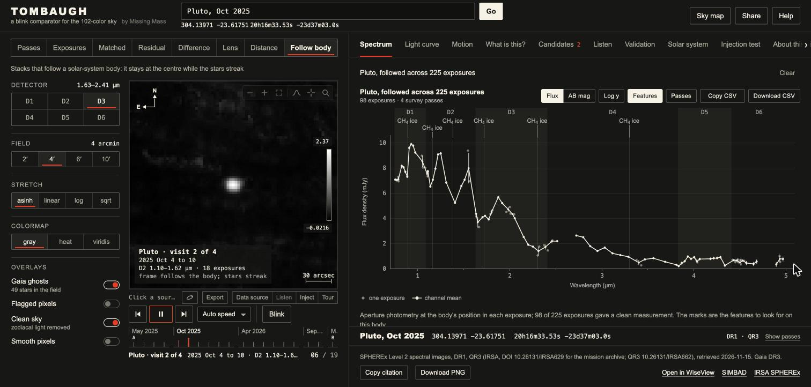
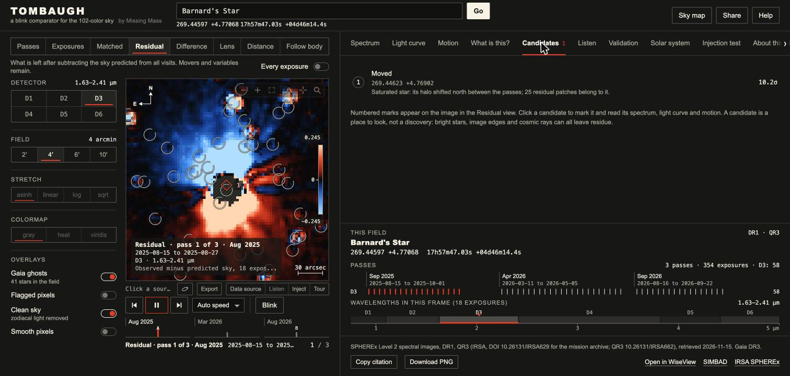
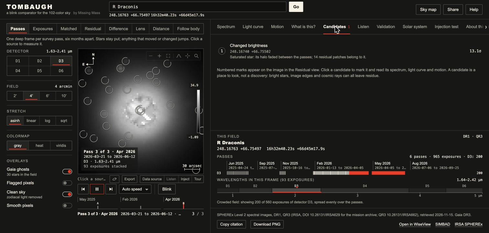

# Judging map

Where to look for each thing a judge scores. Every row points to something that can be opened: a
view of the live tool, a file, or a section of a document. Every number comes from the run on real
SPHEREx data of 15 November 2026 recorded in [docs/RESULTS.md](RESULTS.md).

Live tool: <https://batch-ly.com/tombaugh/index.html> ·
Source: <https://github.com/IshiakiZ/Batchly-Public/tree/claude/tombaugh/apps/tombaugh> ·
Demo: `[DEMO-URL]`

*Real SPHEREx data, from <https://batch-ly.com/tombaugh/index.html?body=pluto>.*

## Judging criteria (each scored 1 to 5)

| Criterion | What Tombaugh offers | Where to see it |
|---|---|---|
| **Impact** | Opens SPHEREx time-domain data to anyone with a browser: no account, no install, no knowledge of the file format. Works for any position on the sky, not only the test targets: its index covers 272,963 exposures. Usable in teaching: proper motion, parallax and molecular absorption from current mission data | [Live tool](https://batch-ly.com/tombaugh/index.html), landing page and tour; [ARCHITECTURE.md](ARCHITECTURE.md#new-data-releases-without-code-changes) |
| | States plainly what it cannot do, so nobody is misled about Planet X. No new object is claimed | [README limits](../README.md#limits); [docs/RESULTS.md section 8](RESULTS.md#8-what-these-results-do-not-show) |
| **Creativity** | Predicted-sky subtraction: a reference image built from the spectrum, because SPHEREx never repeats a colour | [Barnard's Star, residual view](https://batch-ly.com/tombaugh/index.html?name=Barnard%27s%20Star&view=residual&det=3); [SCIENCE.md section 4](SCIENCE.md#4-predicted-sky-subtraction) |
| | Follow a body: Pluto held still across 225 exposures while the stars streak, with a 0.76 to 4.97 um spectrum that shows methane ice. The object Clyde Tombaugh found with a blink comparator | [`?body=pluto`](https://batch-ly.com/tombaugh/index.html?body=pluto); [docs/RESULTS.md section 6](RESULTS.md#6-pluto-following-a-body-that-moves) |
| | Distance dial: focus the survey at a chosen distance by undoing the parallax. Molecule lenses: colour the field by chemistry | `view=distance`; `view=lens&lens=methane`; [SCIENCE.md section 8](SCIENCE.md#8-the-distance-dial) |
| | Gaia rings that a moving star leaves behind; fog-of-war map of the unexplored sky; spectra played as sound | `gaia=1`; Sky map; Listen tab |
| **Validity** | Five of five challenge targets measured against catalogues. All 34 comparisons agree within 3 sigma | Validation tab, "Run the five challenge targets"; [docs/RESULTS.md section 2](RESULTS.md#2-the-five-challenge-targets) |
| | Barnard's Star: 11903 ± 2426 mas/yr at 355 ± 12 deg, against 10380 mas/yr at 356 deg (+0.6 sigma). Clicking the star in the main view gives the same answer: 11 ± 3 arcsec/yr at 357°, Gaia 10.39 arcsec/yr at 356° | Validation tab; Motion tab; [docs/RESULTS.md sections 2 and 4](RESULTS.md#2-the-five-challenge-targets) |
| | Controls on ordinary field stars: they land within 0.3 arcsec of Gaia; stars that should not move show zero motion within the error in every field; residual noise is 0.94 to 1.69 times the model | [docs/RESULTS.md section 3](RESULTS.md#3-controls-how-far-the-numbers-can-be-trusted) |
| | Blind search: every challenge target is the one candidate in its own field; none on nine empty control fields (eight false alarms on bright stars were found there first, traced, and removed by a net-light test). Planted bodies give the reach: half recovered at 51 µJy at 500 AU | Candidates tab; [docs/RESULTS.md section 5](RESULTS.md#5-blind-search-for-things-that-changed) |
| | The tool declines a false result: a ×2.19 jump on WISE 0855 is rejected because a Gaia star sits 3.3 arcsec away on those dates | [docs/RESULTS.md section 2](RESULTS.md#2-the-five-challenge-targets), Brightness |
| | The code agrees with Astropy on 232 comparisons. 995 unit tests and 12 end-to-end browser checks pass | [CROSSCHECK.md](CROSSCHECK.md); `node --test` |
| | Failure modes named: undersampling, PSF change with wavelength, sharp spectral features, saturation, crowding, few passes | [SCIENCE.md limits](SCIENCE.md#limits-and-failure-modes) |
| | Uses the pipeline's own flags, variance and zodiacal model; follows FITS WCS, SIP and HEALPix as published | [SOURCES.md](SOURCES.md#4-standards-and-methods) |
| **Relevance** | Meets the objective as written: public web tool, RA and Dec in, a movie of SPHEREx images out, moving objects made easy to spot, tested on the five named targets | Table below |
| | Addresses every optional consideration, and says which one is only partly met (WISE overlay) | Table below |
| **Presentation** | 30-second demo in three beats: Pluto, Barnard's Star, the validation result | `[DEMO-URL]`; [DEMO-SCRIPT.md](DEMO-SCRIPT.md) |
| | The tool explains itself: a first screen with one sentence and five targets, short explainer cards for each idea, captions with date and wavelength on every frame, a guided tour, keyboard help | [Live tool](https://batch-ly.com/tombaugh/index.html); [`?story=tour`](https://batch-ly.com/tombaugh/index.html?story=tour); `?` key |
| | Complete written submission, full source list, plain AI disclosure | [SUBMISSION.md](SUBMISSION.md); [SOURCES.md](SOURCES.md); [AI-USE.md](AI-USE.md) |

## Challenge objective

Measured values are from [docs/RESULTS.md section 2](RESULTS.md#2-the-five-challenge-targets). Proper
motions are in mas/yr; the catalogue value is what a perfect measurement on the same dates would
give.

| The challenge asks for | Feature | Where to see it |
|---|---|---|
| A public-facing web tool | One page, public, no sign-in | <https://batch-ly.com/tombaugh/index.html> |
| Users enter RA and Dec | Search box takes decimal degrees, sexagesimal (`17h57m48.5s +04d41m36s`, `17:57:48.5 +04:41:36`) or a name | Search box; `?ra=..&dec=..`; `?name=..` |
| Display a series of SPHEREx images of that patch like a little video | Movie player: play, pause, speed, step, blink A/B. Frames are every exposure in time order, or one stack per survey pass | `view=exposures`; `view=passes` |
| Making it easy to spot moving objects | Residual movie; Candidates tab; Gaia rings; motion meter | `view=residual`; `gaia=1` |
| Test on Barnard's Star | Measured 11903 ± 2426 at 355 ± 12 deg. Catalogue 10380 at 356 deg (+0.6 sigma). 3 passes, D3. Blind search: 1 candidate, "Moved" | [Open](https://batch-ly.com/tombaugh/index.html?name=Barnard%27s%20Star&view=residual&det=3) |
| Test on Epsilon Indi B | Measured 4511 ± 648 at 125.9 ± 8.2 deg. Catalogue 4635 at 123.9 deg (−0.2 sigma). 4 passes, D6. Methane band depth 0.600 ± 0.002 | [Open](https://batch-ly.com/tombaugh/index.html?name=Epsilon%20Indi%20B&det=6) |
| Test on WISE 0855 | Detected. Measured 8016 ± 1249 at 277.9 ± 8.9 deg. Catalogue 8169 at 274.6 deg (−0.1 sigma). 3 passes, D6. Median signal-to-noise 4.7 per exposure | [Open](https://batch-ly.com/tombaugh/index.html?name=WISE%200855-0714&det=6) |
| Test on RW Aurigae | Brightness ×1.397 ± 0.041 (11.0 sigma), Sep 2025 → Mar 2026, D2. No motion detected, as expected | [Open](https://batch-ly.com/tombaugh/index.html?name=RW%20Aurigae&det=2) |
| Test on R Draconis | Brightness ×0.717 ± 0.056 (4.3 sigma), Mar 2026 → Apr 2026, D3. No motion detected, as expected. Blind search: 1 candidate, "its halo faded", 13.1 sigma | [Open](https://batch-ly.com/tombaugh/index.html?name=R%20Draconis&det=3) |

| | |
|---|---|
|  |  |
| Barnard's Star: the residual of a star that moved north. Real data. | R Draconis: a saturated star whose halo faded. Real data. |

## Optional considerations

| Consideration | Feature | Where to see it | Met |
|---|---|---|---|
| Easy to update with new releases | Frames come from this project's index of NASA's public SPHEREx bucket; a new week of data is added by running the index build; release read from the file path; passes found from time gaps; DOIs in one constant | [ARCHITECTURE.md](ARCHITECTURE.md#new-data-releases-without-code-changes); citation line under each view | Yes |
| Creative display of the 102 bands, for example adding together each of the six detector arrays | Per-pass stack for each of the six detectors (keys `1` to `6`); matched-channel view; molecule lenses; three-detector colour | `view=passes&det=1..6`; `view=matched&ch=..`; `view=lens&lens=rgb` | Yes |
| Extra kudos: spectra on the fly | Click any position: aperture photometry on every loaded frame, plotted against wavelength, with a light curve and CSV export. Pluto's spectrum covers 0.76 to 4.97 um | Click in the viewer; [`?body=pluto`](https://batch-ly.com/tombaugh/index.html?body=pluto) | Yes |
| Add or subtract images taken at different times | Add or subtract any two passes; and the residual view, which subtracts a predicted image | `view=diff`; `view=residual` | Yes |
| User-chosen field of view | 2, 4, 6 or 10 arcminutes | `fov=` | Yes, four sizes |
| Overlays from Gaia or WISE | Gaia DR3 rings with proper motion. WISE sources are not overlaid; a link opens WiseView at the same coordinates | `gaia=1`; "Open in WiseView" | Gaia yes, WISE by link only |
| Coordinates in the URL so it can be embedded | Whole view state in the URL; `embed=1` hides the chrome; runs in a sandboxed iframe | Address bar; [README](../README.md#try-it) | Yes |
| Metadata such as contamination flags | Flag overlay with named bits; date, wavelength, observation id and release for each frame; photometry notes flagged pixels | `flags=1`; frame caption | Yes |
| Reuse of public tools such as Astropy and Aladin | Public services and standards are reused (NASA's SPHEREx bucket, IRSA, Gaia, CDS Sesame and SIMBAD, JPL Horizons, FITS WCS, SIP, HEALPix), and the design follows WiseView. Astropy checks the code (232 comparisons pass) but is not bundled: the page has no dependencies so that it ships as one embeddable file. Aladin is not used | [SOURCES.md](SOURCES.md); [CROSSCHECK.md](CROSSCHECK.md) | Partly |

## Awards the project could fit

| Award | The case | Evidence |
|---|---|---|
| Best Use of Science | A stated method with a noise model, a built-in comparison against Gaia, null tests and named failure modes | 5 of 5 targets measured; 34 comparisons within 3 sigma; null tests zero within error in every field ([docs/RESULTS.md](RESULTS.md)) |
| Best Use of Data | SPHEREx's own data model (a wavelength for every pixel, flags, variance, zodiacal model) is used in full, and the awkward property of the data, no repeated colour, is turned into the method | Pluto's spectrum from 225 exposures; Epsilon Indi Ba,Bb methane depth 0.600 ± 0.002; an index of 272,963 exposures |
| Best Use of Technology | Reads only the needed rows of 65 MB files and sends about 72 kB per frame; all science in the browser with no libraries; one-file build; embeddable by URL | [ARCHITECTURE.md](ARCHITECTURE.md); the live tool loading a target |

## What is not there

Stated here so that it is not found by surprise.

- The 16-year SPHEREx-plus-WISE movie was planned and not built.
- No new object is claimed. The blind search was checked on nine control fields.
- The injection test was run on one control field: half of the planted bodies at 500 AU are
  recovered at 51 µJy, about twice as bright as a Neptune-size planet there. The distance dial
  was not measured in the recorded run; no number is quoted for it.
- Motions under about 1 arcsec/yr cannot be seen with this pixel size and this time span.
- Aladin is not used. Astropy is used only to check the code.
