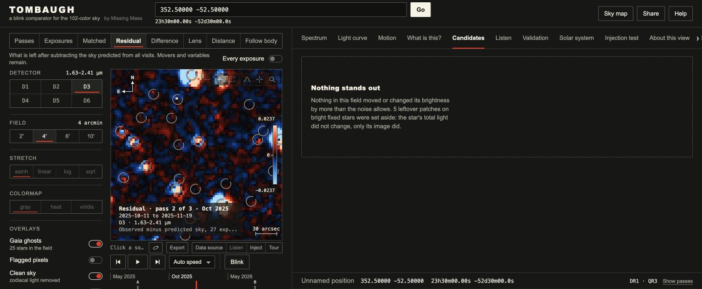
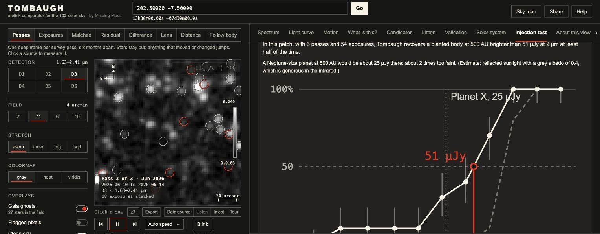

# Results on real SPHEREx data

Everything on this page was measured by Tombaugh itself, in a browser, on real SPHEREx Level 2
spectral images (Data Release 1 and Quick Release 3) on 15 November 2026. Nothing here comes from
the synthetic test sky. Each number can be reproduced from the live tool: the link or the button
that produces it is named beside it.

The catalogue values in the tables are not typed in by hand. The Validation tab reads them at run
time (Gaia DR3 for stars; published values for the two brown dwarfs, which Gaia does not list) and
turns them into "what a perfect measurement on these dates would give", parallax included.

Screenshots from these runs are in [real/](real/).

## 1. Headline

- **Five of five challenge targets measured. All 34 comparisons with the catalogues agree within
  3 sigma** (Validation tab, "Run the five challenge targets", run of 2026-11-15 10:44 UTC; a
  second run an hour later gave the same verdict).
- **Three fast movers recovered** from 6-arcsecond pixels and two to four visits: Barnard's Star,
  Epsilon Indi Ba,Bb and WISE 0855-0714, each with the right speed and the right direction.
- **Two variables recovered**: RW Aurigae rose by 40 % between September 2025 and March 2026
  (11 sigma); R Draconis fell by 28 % between March and April 2026 (4.3 sigma).
- **Methane seen twice**: in the T dwarfs Epsilon Indi Ba,Bb (3.3 µm band depth 0.600 ± 0.002) and
  as ice on Pluto, whose spectrum shows the methane-ice bands at 0.89, 1.16, 1.38, 1.72, 2.3 and
  3.3 µm.
- **Blind search works**: with no catalogue input, the candidate list on Barnard's field holds one
  entry, "moved, halo shifted north". On nine empty control fields it holds none.
- **The search's reach is measured**: in a typical patch, a planted body at 500 AU is recovered
  half of the time at 51 µJy (2 µm). A Neptune-size planet there would be about 25 µJy.

## 2. The five challenge targets

Proper motions are in milliarcseconds per year (mas/yr). "Sigma" is the difference from the
catalogue divided by the measurement's own 1-sigma error.

### Motion

| Target | Passes used | Measured total | Catalogue | Sigma | Measured direction | Catalogue |
|---|---|---|---|---|---|---|
| Barnard's Star | 3 (Aug 2025, Mar 2026, Aug 2026), D3 | 11903 ± 2426 | 10380 | +0.6 | 355 ± 12 deg | 356 deg |
| Epsilon Indi Ba,Bb | 4 (Apr 2025 to Sep 2026), D6 | 4511 ± 648 | 4635 | −0.2 | 125.9 ± 8.2 deg | 123.9 deg |
| WISE 0855-0714 | 3 (May 2025, Nov 2025, Apr 2026), D6 | 8016 ± 1249 | 8169 | −0.1 | 277.9 ± 8.9 deg | 274.6 deg |
| RW Aurigae | 3 (Sep 2025, Mar 2026, Sep 2026), D2 | 1189 ± 666 | 25 | +1.7 | no motion detected | |
| R Draconis | 3 (May 2025, Mar 2026, Apr 2026), D3 | 2082 ± 1173 | 21 | +1.8 | no motion detected | |

The two variables are the controls for motion: they should not move, and they do not (under
2 sigma). Barnard's Star saturates the detector, so each of its positions is taken from the
unsaturated light around the flagged core; that is why its error is the largest.

Components for the three movers:

| Target | East, measured | East, catalogue | North, measured | North, catalogue | Parallax fitted | Parallax, catalogue |
|---|---|---|---|---|---|---|
| Barnard's Star | −1022 ± 2426 | −667 | 11859 ± 2426 | 10359 | 1537 ± 551 mas | 547 mas |
| Epsilon Indi Ba,Bb | 3655 ± 648 | 3849 | −2644 ± 648 | −2583 | 329 ± 402 mas | 271 mas |
| WISE 0855-0714 | −7939 ± 1249 | −8143 | 1104 ± 1249 | 656 | 187 ± 513 mas | 439 mas |

The parallaxes are consistent with the catalogue but not detections on their own: SPHEREx revisits
a position about every six months, which is the worst cadence for parallax.

### Brightness

| Target | Result | Detail |
|---|---|---|
| RW Aurigae | **×1.397 ± 0.041 (11.0 sigma)**, Sep 2025 → Mar 2026, D2 | then steady: ×0.963 ± 0.029 to Sep 2026 |
| R Draconis | **×0.717 ± 0.056 (4.3 sigma)**, Mar 2026 → Apr 2026, D3 | steady before: ×1.029 ± 0.098, May 2025 → Mar 2026 |
| Barnard's Star | no change: largest is ×1.245 ± 0.098 (2.9 sigma) | |
| Epsilon Indi Ba,Bb | no change: D6 pairs ×1.005 ± 0.023, ×0.997 ± 0.022, ×0.977 ± 0.022, ×0.980 ± 0.023 | steady to about 2 % over 17 months |
| WISE 0855-0714 | no change counted: D6 ×0.991 ± 0.106 | a ×2.19 jump in D4 is rejected because a G = 16.3 Gaia star sits 3.3 arcsec away on those dates |

The last row matters as much as the first two. The tool tracks where the brown dwarf is on each
date, finds that a background star is inside the aperture on some dates and not others, and
declines to call the difference a brightening.

### Spectrum

| Target | Exposures with clean photometry | Coverage | Median signal-to-noise per exposure | Depth of the 3.15–3.45 µm methane band |
|---|---|---|---|---|
| Epsilon Indi Ba,Bb | 109 of 135 | 2.44–5.01 µm | 63 | **0.600 ± 0.002** |
| WISE 0855-0714 | 68 of 79 | 2.43–5.00 µm | 4.7 | 0.175 ± 0.071 |

A depth of 0 is a smooth spectrum. Epsilon Indi Ba,Bb are T dwarfs and methane removes 60 % of
their light in this band. WISE 0855 is near the detection limit in single exposures; its band is
seen at 2.5 sigma.

## 3. Controls: how far the numbers can be trusted

Measured on ordinary field stars in the same fields, by the same code.

| Field | Reference stars | Median offset from Gaia | Scatter per axis | Null test, east | Null test, north | Residual / sigma on blank sky |
|---|---|---|---|---|---|---|
| Barnard's Star | 6 | 0.13 arcsec | 0.69 arcsec | 7 ± 561 | 41 ± 561 | 1.14 |
| Epsilon Indi Ba,Bb | 22 | 0.04 arcsec | 0.70 arcsec | −44 ± 188 | −135 ± 188 | 1.69 |
| WISE 0855-0714 | 7 | 0.26 arcsec | 0.79 arcsec | −276 ± 1488 | −82 ± 1021 | 1.34 |
| RW Aurigae | 12 | 0.22 arcsec | 0.36 arcsec | 26 ± 163 | 5 ± 163 | 0.94 |
| R Draconis | too few clean stars | | | | | 1.15 |

- **Offset from Gaia.** Field stars land within 0.3 arcsec of where Gaia says they are, about
  one twentieth of a 6.15-arcsec pixel. Frames, resampling and centroids line up.
- **Null test.** The mean measured motion of stars that Gaia says do not move (mas/yr). It is
  zero within its error in every field. This is the honest size of the method's error.
- **Noise.** The residual divided by its predicted sigma should have a standard deviation of 1.
  It is between 0.94 and 1.69: the noise model is right to within tens of percent, and slightly
  optimistic in the crowded Epsilon Indi field.

## 4. The viewer's own readings

Clicking the target in the main view (no Validation tab) gives the same answers:

| Target | Tombaugh | Reference |
|---|---|---|
| Barnard's Star | 11 ± 3 arcsec/yr at position angle 357° | Gaia: 10.39 arcsec/yr at 356° |
| WISE 0855-0714 | 8.2 ± 0.6 arcsec/yr at 281° | published: 8.15 arcsec/yr at 274.8° |
| Epsilon Indi Ba,Bb | 4.7 ± 0.6 arcsec/yr at 128° | catalogue: 4.64 arcsec/yr at 124° |
| RW Aurigae | rose by a factor of 1.4 between Sep 2025 and Sep 2026 (8.6 sigma) | known irregular variable |
| R Draconis | fell by a factor of 2.2 between Feb and Apr 2026 | known Mira variable |

## 5. Blind search for things that changed

The Candidates tab subtracts a model of the unchanging sky and lists what is left, with no
catalogue input.

### On the targets

Each field as its target button opens it (the detector and field size in the built-in target
table, centred on where the object is today), final build, 2026-11-15:

| Field | Opens as | Candidates | Top entry |
|---|---|---|---|
| Barnard's Star | detector 3, 4 arcmin | 1 | "Moved. Saturated star: its halo shifted north between Aug 2025 and Aug 2026; 26 residual patches belong to it." 10.3 sigma |
| Epsilon Indi Ba,Bb | detector 6, 6 arcmin | 2 | "Moved", 30.0 sigma. The second entry is described below |
| WISE 0855-0714 | detector 6, 4 arcmin | 1 | the brown dwarf, 5.9 sigma |
| R Draconis | detector 3, 4 arcmin | 1 | "Saturated star: its halo faded between May 2025 and Apr 2026; 14 residual patches belong to it." 13.1 sigma |
| RW Aurigae | detector 2, 4 arcmin | 1 | "Saturated star: its halo brightened between Sep 2025 and Mar 2026; 5 residual patches belong to it." 19.2 sigma. Three patches on neighbouring stars set aside |

Every challenge target is the top entry in its own field's list, and in four of the five fields
the only one. The numbers move a little with the field centre and the detector (an earlier run
of RW Aurigae paired Sep 2025 with Sep 2026, at 18.6 sigma); which object is listed does not.
RW Aurigae's verdict comes from two passes half a year apart, so its note adds: "These two
passes are half a year apart, with the telescope turned round, so the star's own image can differ
between them: check the light curve before trusting this." The light curve does confirm it
(section 2).

Two more nearby objects were tried the same way, and each is the one entry in its field:
Teegarden's Star, "Moved. Saturated star: its halo shifted south-east between Aug 2025 and Aug
2026" (31.3 sigma; its catalogue motion is 5.1 arcsec a year towards the south-east), and the
brown-dwarf pair Luhman 16, "Moved" (17.3 sigma), in a crowded Galactic-plane field where 19
patches on stars and 4 at the edge were set aside.

### An entry we cannot explain

The second entry in the Epsilon Indi field is "Changed brightness", 7.4 sigma, at
RA 331.07824, Dec -56.76371, 2.4 arcmin from the brown dwarfs and outside a 4 arcmin field. What
Tombaugh shows there:

- A faint source that was brighter in May and June 2025 than in the three passes since. Relative
  to its own average it reads about 2.0 in spring 2025 and 0.5 in both autumns on detector 6
  (4.4 to 5.0 µm), and about 1.5 against 0.8 to 0.9 on detectors 4 and 5 (2.4 to 4.4 µm). The
  Light curve tab calls it a fall "by a factor of 4.0 between May 2025 and Oct 2025
  (6.4 sigma)" on detector 6.
- It stayed bright through the whole first pass, about 40 days, so it is not an asteroid going by.
- It did not come back in spring 2026, so it does not simply follow the telescope's orientation.
- "What is this?" finds nothing in SIMBAD within 12 arcsec, and the nearest Gaia star is
  13 arcsec away.

We do not know what it is, and we do not claim it is new. We did not check the WISE or 2MASS
catalogues. A variable galaxy nucleus or a dust-shrouded star would both fit; so might scattered
light from Epsilon Indi A, a very bright star about 8 arcmin away. It is listed here because this is
what the Candidates tab is for: a place to look, with the evidence one click away.

The Gaia stars loaded for that field hold no match for Luhman 16: the one nearest its position
moves 14 milliarcsec a year. For fast named objects like this one the Motion tab therefore compares with
the published motion in the built-in target table (SIMBAD values) and says so. Its centroid fit on
Luhman 16 reads "Measured 3.1 ± 1.1 arcsec/yr: 2.7 sigma, short of a detection on its own. The
catalogue says 2.79, in the same direction: consistent." The fit is weaker than the residual
search because the pair is faint at 2 µm and the field is crowded. Where Gaia has the object
(Barnard's Star, Epsilon Indi B), the Motion tab keeps using Gaia.

### On empty sky: the false-alarm test

A search is only worth as much as its false-alarm rate, so the same search was run on fields
with nothing known in them. Eight positions were drawn from a fixed grid (15 degrees in RA,
15 degrees in Dec, seeded shuffle) at Galactic latitude above 45 degrees and ecliptic latitude
below 60 degrees, plus the control field used earlier. Detector 3, 4-arcminute field.

| Field (RA, Dec) | Exposures | Passes | Candidates, first run | Candidates, final | Set aside: on stars | Set aside: at the edge |
|---|---|---|---|---|---|---|
| 172.5, −7.5 | 54 | 3 | 1 (12.4 sigma) | 0 | 1 | 2 |
| 202.5, −7.5 | 54 | 3 | 0 | 0 | 0 | 0 |
| 7.5, −37.5 | 86 | 3 | 2 (14.3, 5.9 sigma) | 0 | 1 | 2 |
| 322.5, −52.5 | 75 | 4 | 1 (5.1 sigma) | 0 | 1 | 0 |
| 337.5, −22.5 | 61 | 3 | 0 | 0 | 0 | 0 |
| 7.5, −7.5 | 55 | 3 | 0 | 0 | 0 | 0 |
| 37.5, +7.5 | 53 | 3 | 1 (5.4 sigma) | 0 | 1 | 0 |
| 352.5, −52.5 | 64 | 3 | 3 (11.6, 11.6, 10.3 sigma) | 0 | 3 | 2 |
| 56.25, +34.22887 | 66 | 3 | 0 | 0 | 4 | 0 |

**First run: eight false alarms in five of eight new fields**, all labelled "changed
brightness". Most sat on the flank of an ordinary bright star; some sat where the coverage of
one pass ends. The cause: a fixed star never
subtracts perfectly. SPHEREx samples its image with 6-arcsecond pixels and the telescope is
rotated by half a turn between passes, so the star's image differs a little from pass to pass.
That leaves a bright patch on one flank and a dark one on the other, each many sigma on a bright
star. Measured on those stars, the total light inside a 10-arcsecond disc changed by 1 to 5 %
(at most 3.0 sigma), while single patches reached 14 sigma.

**The fixes.** The net-light test: a patch on a fixed source is listed only if the source's total
light in that disc changed by 5 sigma, which for a bright star is about 9 %. The edge test: a
patch that touches the region where its pass has no data, or the border of the image, is not
listed, because there is nothing there to compare with (found on the M101 field, whose one
candidate sat in a corner that one pass did not cover). The panel says how many patches were
set aside for each reason, and a listed source says by how much its light changed.

**Final run: no candidate in any of the nine fields**, and every challenge target still found.

**Saturated stars are compared a year apart.** Half a year apart the telescope is turned round,
and the halo of a bright star, with its spikes and lopsided skirt, can look fainter or shifted
when nothing changed. Proxima Centauri was at first listed as "faded between Jul 2025 and Feb
2026" although it had moved west. A saturated star's verdict now comes first from passes a whole
number of years apart, where its image is the same. With that rule Teegarden's Star reads
"shifted south-east" (it was "east"), RW Aurigae "brightened between Sep 2025 and Sep 2026", and
Proxima "its halo changed between the passes": its motion of 1.2 grid pixels in a year is too
small for the halo to give a direction, and the tool no longer names one.

*Control field 352.5, −52.5. The residual image still shows the red and blue patches on the
stars. The list is empty, and says why.*

What this does and does not show: nine fields of 4 arcminutes are 0.04 square degrees. Zero in
nine fields is consistent with a false-alarm rate anywhere below about one field in three (95 %
confidence). A patch on a star's flank that the pairing step labels "moved" is not covered by
this test; none appeared in these fields.

### How faint a body the search would catch: the injection test

The Injection test tab plants a simulated body in copies of the real exposures and runs the
same search on them. Ten bodies at each of eight or more brightnesses give a recovery curve.
Run on the control field 202.5, −7.5 (3 passes, 54 exposures, detector 3), body at 500 AU:

- Recovered at least half of the time when brighter than **51 µJy at 2 µm** (AB magnitude 19.6),
  when the search is told where the body is.
- Flagged by the blind candidate list above about **110 µJy** (AB magnitude 18.8).
- A Neptune-size planet at 500 AU would be about 25 µJy (reflected sunlight, grey albedo 0.4,
  which is generous in the infrared): **about 2 times too faint** for this patch.
- At 500 AU a body hops 13.8 arcminutes between passes by parallax, so it is in a 4-arcminute
  field in only one pass: on average each planted body was in view in 25 of the 54 exposures.

This is a test of the tool, not a detection. It turns "nothing was found here" into a number:
nothing brighter than about 110 µJy moved through this patch during these exposures.

Before the saturated-star step was added, Barnard's field listed 12 false "changed brightness"
entries, all of them pieces of one moving halo. That fix, the net-light test, the edge test and
the year-apart rule all came from looking at real data.

## 6. Pluto: following a body that moves

Link: `?body=pluto`. The tool asks JPL Horizons where Pluto was, finds every SPHEREx exposure
that caught it, and stacks them in Pluto's frame so that the stars streak and Pluto stays put.

- 225 exposures in 4 visits: April 2025, October 2025, April to May 2026, September to October 2026.
- 98 exposures gave a clean measurement; 19 stacks in the frame that follows Pluto.
- Spectrum from 0.76 to 4.97 µm, peaking near 10 mJy at 0.93 µm.
- Methane-ice absorption at 0.89 µm, 1.14–1.17 µm, 1.31–1.41 µm, 1.64–1.80 µm (about 48 % deep at
  1.65 µm), 2.15–2.39 µm (about 53 % deep at 2.31 µm), 3.3–3.5 µm and 3.8 µm.

Pluto is the object Clyde Tombaugh found with a blink comparator in 1930. This is the same
search, with 102 colours, done by a web page.

## 7. The data behind it

- Exposure index built by this project from NASA's public SPHEREx bucket: 272,963 exposures in
  273 index units.
- Releases used in the validation run: DR1 (450 exposures) and QR3 (76 exposures).
- Data: SPHEREx Level 2 spectral images, NASA/IPAC Infrared Science Archive. DR1 spectral images
  DOI 10.26131/IRSA678; QR3 DOI 10.26131/IRSA662. Reference catalogue: Gaia DR3, epoch 2016.0.
  Ephemerides: JPL Horizons.

## 8. What these results do not show

- Motions under about 1 arcsec/yr cannot be seen with this pixel size and this time span. The
  error on a single target is 0.6 to 2.4 arcsec/yr.
- Saturated stars (Barnard's Star, R Draconis) have every aperture pixel flagged, so their
  brightness ratios come from the unsaturated wings and are less certain than the formal error.
- No new object is claimed. Nine control fields are 0.04 square degrees of a 41,000 square
  degree sky. A real search for an unknown body needs many fields and a human to look at each
  candidate, which is what the tool is built for.
- The injection test says a Neptune-size body at 500 AU is about twice too faint for a typical
  three-pass patch. The deep fields at the ecliptic poles, and later passes, go deeper.
- The Epsilon Indi field's noise ratio of 1.69 means the noise there is underestimated, so
  significances quoted in that field are somewhat overstated.
