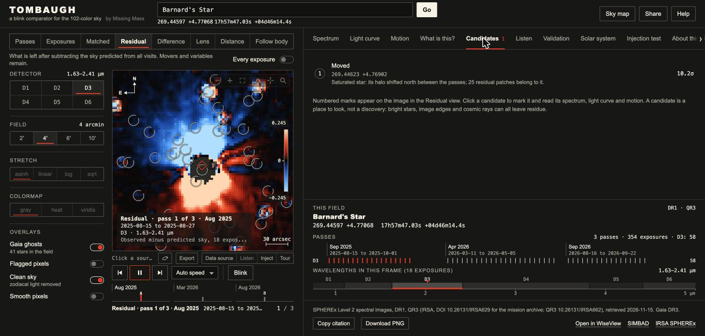
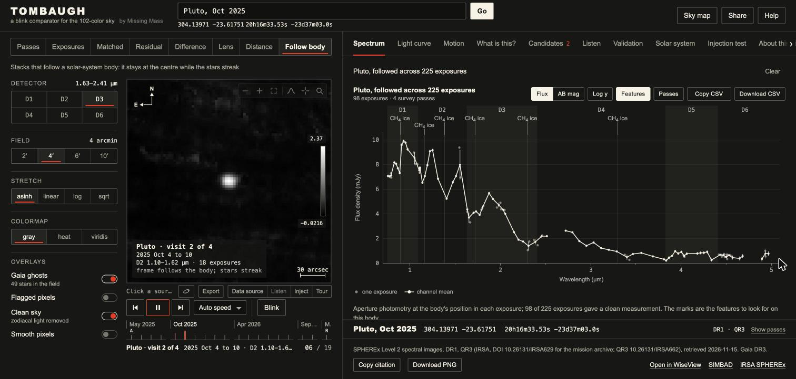

# Tombaugh: the method

Written for a reader who knows astronomy and wants to know what the tool computes, what it assumes
and where it fails.

**How to read this document.** It describes what the code does, as specified in
[CONTRACT.md](../CONTRACT.md), and how the result was checked. Every measured value quoted here
comes from the run on real SPHEREx data of 15 November 2026 that is recorded in
[docs/RESULTS.md](RESULTS.md); that file is the source of truth for the numbers. Catalogue values are
read by the tool at run time (Gaia DR3 for stars, published values for the two brown dwarfs).
Facts about the file format were measured on real files on 14 and 15 November 2026 and are
recorded in [CONTRACT.md](../CONTRACT.md) and [CONTRACT-S3.md](../CONTRACT-S3.md).

Contents:
[1 Data](#1-the-data) ·
[2 Common grid](#2-from-frames-to-a-common-grid) ·
[3 Passes and stacks](#3-passes-stacks-and-the-matched-view) ·
[4 Predicted-sky subtraction](#4-predicted-sky-subtraction) ·
[5 What change looks like](#5-what-change-looks-like) ·
[6 Photometry](#6-photometry-spectra-and-light-curves) ·
[7 Proper motion](#7-proper-motion-and-the-comparison-with-gaia) ·
[8 Distance dial](#8-the-distance-dial) ·
[9 Molecule lenses](#9-molecule-lenses) ·
[10 Validation](#10-validation) ·
[11 Limits](#limits-and-failure-modes)

## 1. The data

**Instrument.** SPHEREx images the sky onto six 2040 x 2040 detectors with 6.15 arcsecond pixels.
A linear variable filter (LVF) sits above each detector, so the wavelength reaching a pixel is a
function of its position on the detector, mostly of its row. There is no filter wheel and no
dispersing element. The spacecraft steps across the sky, and a given sky position lands on a
different row, and therefore a different wavelength, in each exposure. The spectrum of a position
is assembled from many exposures.

| Detector | Wavelength (um) | Channels |
|---|---|---|
| D1 | 0.75 - 1.09 | 17 |
| D2 | 1.10 - 1.62 | 17 |
| D3 | 1.63 - 2.41 | 17 |
| D4 | 2.42 - 3.82 | 17 |
| D5 | 3.83 - 4.41 | 17 |
| D6 | 4.42 - 5.00 | 17 |

Six detectors of 17 channels give the 102 bands. A channel is a range of wavelength, not a fixed
set of pixels, and within a detector the channels are evenly spaced in ln(wavelength) to a good
approximation (constant resolving power per detector).

**Files.** Tombaugh uses Level 2 spectral images: one calibrated exposure of one detector, in
MJy/sr. It reads them from NASA's public SPHEREx bucket on AWS Open Data, which holds the same
files IRSA serves; IRSA's own services are the fallback. Each file has these layers.

| Layer | Use in Tombaugh |
|---|---|
| IMAGE (float32, MJy/sr) | The data |
| FLAGS (int32 bit mask) | Masking, and the flag overlay |
| VARIANCE (MJy2/sr2) | Weights and the noise model |
| ZODI (MJy/sr) | Model of the zodiacal light, subtracted on request (default on) |
| WCS-WAVE (lookup table) | Wavelength and bandwidth of every pixel |
| EPSF | Not used |

Astrometry is a TAN projection with SIP distortion (third order in the files examined). Because
the files are cutouts of a full detector, the reference pixel lies far outside the array and the
SIP polynomial is evaluated at arguments of hundreds of pixels, with non-zero zeroth- and
first-order terms. All terms are honoured.

**Wavelength of a pixel.** The alternate WCS `W` (`WAVE-TAB`, the FITS `-TAB` convention) maps a
cutout pixel to a full-detector pixel; the WCS-WAVE table gives wavelength and bandwidth on an
11 x 11 grid of control points across the detector, interpolated bilinearly. On detector 2 the
wavelength runs from about 1.667 um at row 1 to 1.095 um at row 2040, with a slight curvature
along a row. The table was found to be identical, byte for byte, in a 2025 and a 2026 file of the
same detector. The proxy evaluates it once and sends each frame with a wavelength for every pixel.

**Passes.** The all-sky survey returns to a position about every six months. The exposures used
here run from April 2025 to October 2026, and the five challenge targets were measured with three
or four passes each. At one measured position there were roughly 84 exposures per detector in
total. Each exposure is about 113.6 s (`XPOSURE` in the measured file). The project's index of the
bucket lists 272,963 exposures.

**Units.** Surface brightness in MJy/sr. One MJy/sr over one 6.15 arcsecond pixel is 889 microJy.
Times are MJD (UTC), from `MJD-AVG`. Coordinates are ICRS.

## 2. From frames to a common grid

Every exposure has its own orientation and distortion. Before anything is compared, each frame is
resampled onto one grid per session:

- **Grid.** North up, tangent plane about the requested centre, 3.075 arcsec per pixel (half a
  SPHEREx pixel), wide enough for the chosen field of view.
- **Mapping.** For each grid pixel centre: tangent-plane offset to sky, sky to frame pixel through
  the inverse SIP polynomial, then bilinear interpolation of image, variance and wavelength over
  the good pixels among the four neighbours, with the weights renormalised. Surface brightness is
  an intensive quantity, so no flux scaling is needed.
- **Mask.** A grid pixel is unusable if it falls off the frame or if its nearest detector pixel
  is non-finite or carries any of the default bad bits: TRANSIENT, OVERFLOW, SUR_ERROR, NONFUNC, MISSING_DATA, HOT,
  COLD, NONLINEAR, PERSIST, OUTLIER, STREAK, BLOOM, SNOWBALL (bits 0, 1, 2, 6, 9, 10, 11, 15, 17,
  19, 25, 26, 27). The SOURCE bit (21) marks a pixel mapped to a known source and is not a defect.
- **Zodiacal light.** The ZODI layer is subtracted before resampling unless the user turns it off.
  The zodiacal foreground changes between passes because the line of sight through the
  interplanetary dust changes, so leaving it in adds a pass-to-pass offset that is not
  astrophysical change in the target field.

The result is a **layer**: image, variance, per-pixel wavelength and mask on the common grid, with
the time and detector of the exposure.

Three consequences of the resampling matter later. The grid oversamples the detector by two, so
neighbouring grid pixels are correlated. Bilinear interpolation smooths, by an amount that depends
on where the grid pixel falls relative to the detector pixels. And the variance is interpolated
with the same weights as the image, which never understates the noise of a single grid pixel but
does not describe the correlation between neighbours. For that reason photometry is done on the
native frames, not on the grid.

## 3. Passes, stacks and the matched view

**Passes.** Layers are sorted in time and split wherever the gap exceeds 45 days.

**Per-pass stacks** (`view=passes`, the default). Each layer first has its own robust sky level
removed (a clipped median), because zodi-subtracted frames still carry small offsets. All layers
of one detector in one pass are then combined, by default with an inverse-variance weighted mean
with 3-sigma clipping; median and sum are available. The clipping is done about the per-pixel
median with a scale that adds, to each sample's pipeline variance, the excess scatter measured
from the median absolute deviation. In SPHEREx data a real source scatters more than its noise
from exposure to exposure because the wavelength changes; the excess term keeps that from being
clipped as if it were a defect.

The stack is in effect a broadband image through that detector's whole wavelength range, about 28
exposures deep if the 84 are shared evenly among three passes. Blinking the stacks is the nearest
thing to a classical blink comparator that these data allow. The stacks are not identical in
effective wavelength from pass to pass, because each pass samples the detector's range at
different wavelengths, so a very red or very blue source can differ slightly between stacks
without having changed.

**Matched view** (`view=matched`). For a chosen channel, the tool keeps only the layers in which
the target was seen in that channel and shows one image per pass. This is a like-for-like blink at
nearly one wavelength. It uses few exposures, so it is noisier, and the match is exact only at the
centre: across a 4 arcminute field (39 detector rows of 2040) the wavelength drifts by about a
third of a channel, and across 10 arcminutes by about 0.8 of a channel.

**Exposures** (`view=exposures`). Every exposure in time order, with its date and wavelength in the
caption. This is the naive blink movie. It is kept because it shows the problem plainly.

**Add and subtract** (`view=diff`). Any two pass stacks, added or subtracted pixel by pixel.

## 4. Predicted-sky subtraction

The question is whether a frame differs from what the unchanging sky would have produced. The
difficulty is that no two frames of a position share a wavelength, so there is no reference image
to subtract. Tombaugh builds one from the spectrum.

**Model.** For each grid pixel `p` and one detector, the surface brightness is modelled as a
low-order polynomial in ln(wavelength):

```
S_p(lambda) = sum_{k=0..K} c_{p,k} * (ln lambda - ln lambda_0)^k        K = 2 by default
```

where `lambda_0` is a reference wavelength in the detector's range. The fit uses every layer of
that detector, from all passes together: about 84 points for 3 coefficients.

**Why ln(wavelength), and why one detector.** Channels are evenly spaced in ln(wavelength), so the
samples are evenly spread in the fit variable. One detector spans a factor of about 1.1 to 1.6 in
wavelength, over which stellar and galaxy continua are smooth enough for a quadratic. Across
detector boundaries the PSF, the calibration and the noise all change, so the model does not try
to bridge them.

**Fit.** Weighted least squares with weights `1 / variance` from the resampled VARIANCE layer,
using each layer's own wavelength at that pixel. Masked samples are never used. The order adapts
to the data at each pixel: quadratic with at least 8 samples spanning a third of the detector's
range, linear with at least 4, a constant with at least 2, no model otherwise. A small ridge term
on slope and curvature keeps poorly conditioned pixels stable without biasing the level.

A plain least-squares fit would be pulled toward the very objects the tool is looking for, which
dilutes their signal and leaves a negative imprint in the other passes. So the fit is made robust
at two levels, over 3 iterations with weights recomputed from scratch each time:

1. **Per sample.** Normalised residuals are compared with their median, on a scale of the larger
   of 1 and 1.4826 times their median absolute deviation. Samples get Huber weights (full weight
   within 1.345 scale units, falling beyond) and are cut entirely beyond 3.5. This removes cosmic
   rays, satellite trails and anything bright enough to stand out in one exposure. A pixel that
   scatters more than its noise, such as an undersampled star core, gets a proportionally wider
   tolerance.
2. **Per pass.** With at least three passes, the mean residual of each pass at a pixel is
   compared with the median of the pass means, and a pass that disagrees is down-weighted or
   dropped at that pixel. This catches a mover or a variable that is too faint to be an outlier
   in any single exposure but is significant in the average of a pass. The static model is then,
   in effect, the sky as the majority of passes saw it.

The model stores, for every pixel, the coefficients, the rms of the samples used (`rms`), their
number (`nUsed`), and two noise floors described below.

**Prediction and residual.** For a layer `i`, the predicted image is the model evaluated, pixel by
pixel, at the wavelength that pixel had in that exposure:

```
P_i(p) = S_p(lambda_i(p))
R_i(p) = I_i(p) - P_i(p)
snr_i(p) = R_i(p) / sigma_i(p)
```

with

```
sigma_i(p)^2 = variance_i(p) + floor(p)
floor(p)     = excess scatter of the pixel about its model + variance of the model itself
```

The residual movie (`view=residual`) shows one residual image per pass: the residuals of the
pass's exposures combined with a clipped inverse-variance mean, on a diverging colour scale so
that positive and negative are told apart at a glance. Its significance is

```
snr_pass(p) = mean residual / sqrt(variance of the mean + stack floor(p))
```

The floor is added once and does not shrink with the number of exposures, because the model's
error and a pixel's unexplained scatter are common to the whole pass. For a pass that took part
in the fit this is conservative. For a pass the fit rejected at that pixel, which is the case of
interest, it is the right significance.

**What cancels.** Any source whose position and spectrum are constant, and whose spectrum is
smooth across the detector, to the accuracy of the fit. Diffuse emission cancels the same way. The
zodiacal model and a robust per-layer background level deal with foreground that changes between
exposures.

**What does not cancel**, and is not change, is listed under
[Limits and failure modes](#limits-and-failure-modes). The short version: sharp spectral features,
undersampled bright stars, and PSF variation with wavelength.

**Noise in the residual.** Three things to keep in mind when reading `snr`:

1. Resampling correlates neighbouring grid pixels, so a 2 x 2 block of high `snr` is closer to one
   independent detection than to four. The candidate finder requires a peak to have neighbours of
   the same sign for this reason, and does not count pixels.
2. The model was fitted to the same data it is subtracted from. With about 84 points and 3
   parameters the loss of variance is a few percent, and the floor includes the model's own
   variance. A pixel with few usable points has a lower-order model or none.
3. The pipeline variance describes read noise and photon noise. It does not describe sub-pixel
   sampling effects, which dominate for bright stars. That is what the excess-scatter term in the
   floor is for: a bright star core that jitters from exposure to exposure is given a
   correspondingly large sigma, so it does not look like a discovery. The price is reduced
   sensitivity to real change on top of bright stars.

## 5. What change looks like

**A mover that shifts by less than the PSF between passes** (Barnard's Star: about 5.2 arcsec per
pass against a PSF of about 7.5 arcsec FWHM (`PSF_FWHM` is 7.46 in the measured file, which the
code reads as arcseconds) and 6.15 arcsec pixels).
The model describes a source at an intermediate position, close to where the star was in the
middle pass. In an early pass the star is behind that position and in a late pass it is ahead.
The residual is therefore a **dipole**: positive on the side the star is on, negative on the
other, with the sign pattern reversing from the first pass to the last. The axis of the dipole is
the direction of motion.

**A mover that shifts by more than the PSF.** The source is at any one position in only one pass,
the fit rejects that pass there, and the model at that position is just the background. The
residual shows a positive source that appears at a new position each pass.

**A variable.** The model describes the brightness the majority of passes agree on. The residual
is a single-signed **pulse** at a fixed position: positive in passes where the star is brighter,
negative where it is fainter, with no spatial sign change.

**A transient or a moving solar-system body within one pass** appears in one or a few consecutive
exposures only. The clipped per-pass residual removes it, as it removes cosmic rays; it shows in
the residuals of single exposures.

**The change map.** For each pixel, the squared pass significances are summed into a chi-square
and converted to an equivalent Gaussian sigma: the significance that the pass residuals are not
all zero. About 5 and above is worth a look.

**Candidates.** A peak is a pixel whose pass `snr` reaches 5 in absolute value, is the extreme of
its 3 x 3 neighbourhood, and has at least two neighbours of the same sign above half the
threshold. Peaks are then labelled by a deliberately simple rule. Something that moved leaves
displaced blobs: a positive one where it is in this pass, and either a negative one beside it in
the same pass or blobs at a neighbouring position in other passes. So a peak with another peak
between 1.5 and 4 grid pixels away (4.6 to 12.3 arcsec) is labelled **moved**, unless that
neighbour is in the same pass with the same sign. Every other peak is labelled **varies**: a
variable, a transient, or a mover too fast to pair up within that radius. The interface lists up
to 20 candidates, strongest first, each with a position that can be clicked. A candidate is a
place to look, not a detection: see the failure modes.

**Saturated stars are one candidate.** A star that saturates the detector has a flagged core, and
its halo leaves many residual patches. The finder first looks for round patches of at least 9 grid
pixels that are flagged in more than half of the exposures (`saturatedCores` in
`web/src/core/skymodel.js`). Every residual patch within the halo of such a core is grouped into
one candidate. The halo as a whole then says what happened (`haloChange`): a residual that flips
sign across the star between the first and last pass means the star moved, and the direction is
reported; a residual of one sign all round means it brightened or faded. On real data this turned
12 false "changed brightness" entries on Barnard's field into one entry, "Moved. Saturated star:
its halo shifted north", at 10.2 sigma. R Draconis gives one entry, "its halo faded", at
13.1 sigma ([docs/RESULTS.md](RESULTS.md), section 5).

**Stars that are not saturated: the net-light test.** Run on eight empty control fields of real
data, the search at first raised eight "changed brightness" alarms. Every one sat on the flank
of an ordinary bright star. A fixed star never subtracts perfectly: its image is sampled by
6-arcsecond pixels and the telescope is rotated by half a turn between passes, so the image
differs a little from pass to pass. The difference is a bright patch on one flank and a dark one
on the other. Each can be many sigma, because the star is bright, yet the star's total light is
unchanged. So for a patch that sits on a fixed source (the model there is at least three times
brighter than the patch), Tombaugh adds up the residuals of each pass in a disc of radius 3.5
grid pixels (about 11 arcsec) round the source and compares the sum with the model's light in
the same disc. The patch is listed only if that net change reaches 5 sigma; on a bright star
that is a change of about 9 %. On the control stars the net change was 1 to 5 % and at most
3.0 sigma. After the change all nine control fields list nothing, every challenge target is still
listed, and the panel reports how many patches were set aside. A patch with no source under it (a
new object, a mover in one pass) is not subject to the test.

**The edge of the data.** Where the coverage of one pass ends inside the field, the model has
nothing to compare that pass with, and the residual there is not a change. A patch that touches
the region where its pass has no data out to the border of the image, or the border itself, is
set aside and counted. A flagged region in the middle of the field (a saturated core, a bad
pixel) is not an edge. Found on the M101 field, whose one candidate sat in a corner that one
pass did not cover.

**Saturated stars are compared a year apart.** SPHEREx returns to a position every six months
with the telescope turned round by half a turn. The halo of a bright star is not symmetric (it
has spikes and a lopsided skirt), so half a year apart it can look fainter or shifted when
nothing changed. A whole number of years apart the orientation is the same and the star's own
image cancels. The verdict on a saturated star (moved, brightened, faded) is therefore taken
first from pairs of passes within 60 days of a whole number of years apart, and from other
pairs only if those give none. On real data this changed Teegarden's Star from "shifted east"
to "shifted south-east" (its catalogue direction), and stopped Proxima Centauri from being
listed as "faded" when it had moved. When a verdict does have to come from a pair that is not
a year apart, the candidate's note says so: the telescope was turned round between those two
passes, and the star's own image may account for what is seen.



*Real SPHEREx data, detector 3. The blue and red halves are the residual of a star that moved
north between passes; the hatched core is saturated.*

**Gaia rings.** With `gaia=1` the viewer draws a ring for each Gaia DR3 source in the field. A
star with a large proper motion is no longer where the catalogue epoch (2016.0) put it and sits
outside its ring. Barnard's Star has moved about 100 arcseconds, 16 pixels, since 2016.0. The
rings also show at a glance whether the frame astrometry and the resampling are right: ordinary
field stars should sit centred in theirs.

## 6. Photometry, spectra and light curves

**Aperture photometry** is done on the native frames, not on the resampled grid, so the
interpolation does not enter. For each frame the position is converted to pixel coordinates and
the flux is summed in a circular aperture of radius 1.6 pixels (9.8 arcsec), with the background
taken from an annulus of 3.5 to 6 pixels (21.5 to 36.9 arcsec). Surface brightness is converted at
889 microJy per MJy/sr per pixel. Each measurement carries the wavelength and bandwidth of the
pixel at the source position, the time, an error from the VARIANCE layer and a `flagged` mark if
bad pixels fall in the aperture.

**Spectrum.** One point per frame, sorted by wavelength, across all detectors that were loaded;
optionally binned to one point per channel. The plot shades the detector ranges and can export
CSV.

**Light curve.** Each exposure is at a different wavelength, so raw fluxes cannot be compared in
time. The light curve divides each flux by a smooth spectrum fitted to all points of the source
and plots the ratio against time. For a constant source with a smooth spectrum the ratio is 1
within errors at all times.

**Aperture correction.** The 1.6 pixel aperture misses about 5 percent of a star's light, and the
amount changes with where in a pixel the star sits. Each flux is divided by the fraction of a
Gaussian PSF of the frame's own width that the aperture would catch at that sub-pixel position.
The real PSF has faint wings, so absolute fluxes can still be low by a few percent; ratios within
one source are much less affected.

**Saturated stars.** When every aperture pixel is flagged, as for Barnard's Star and R Draconis,
brightness ratios are taken from the unsaturated wings of the star. They are less certain than
their formal errors.

**Blends.** A moving target can drift past a background star. For each date the Validation tab
works out where the target was and looks for a Gaia star within 9 arcsec, inside the aperture
(`blendAt` in `web/src/plugins/validate/measure.js`). A brightness change between a blended date
and a clean one is not counted. On WISE 0855-0714 this rejected a ×2.19 jump in detector 4: a
G = 16.3 Gaia star sits 3.3 arcsec away on those dates.

**Caveats.** The annulus is contaminated in crowded fields. For a source whose spectrum changes
shape as it varies, as a Mira variable's does, the ratio mixes brightness change with spectral
change.

## 7. Proper motion and the comparison with Gaia

This is the tool's quantitative check on itself, and it runs in the browser for any star the user
clicks.

1. **Centroid.** In each pass stack (or each layer), an iterated Gaussian-windowed first moment
   about a local median background gives a sub-pixel position (the windowed centroid of Bertin &
   Arnouts 1996), in a window of half-width 5 grid pixels. It is converted to RA and Dec. The
   error per axis combines in quadrature the noise-limited estimate, 0.6 FWHM / SNR, and a floor
   of 0.05 grid pixels for undersampling and resampling.
2. **Fit.** A weighted straight-line fit in the tangent plane gives `pmra` (including cos Dec),
   `pmdec`, the total motion, its position angle and errors, in mas/yr. Formal errors are
   inflated when the scatter about the line is larger than the weights imply. With three or more
   passes a second fit also solves for parallax, when the geometry allows it.
3. **Compare.** The nearest Gaia DR3 source is moved from epoch 2016.0 to each observation date
   with the standard model of uniform space motion, applied as a vector so that it is exact for a
   10 arcsec/yr star over a decade, plus the parallax for Earth's position on that date. That is
   the expected track. The motion meter shows the measured vector beside Gaia's. For a fast
   named object that Gaia does not list (some brown dwarfs), it shows the published motion from
   the built-in target table instead and labels it "catalogue"; a fit under 3 sigma that has
   the catalogued size and direction is reported as consistent, never as a detection.

**Saturated stars.** A star with a masked core cannot be centroided at its peak. Its position is
taken from the unsaturated light around the flagged core (`centroidWings` in
`web/src/core/astrometry.js`). This is why Barnard's Star has the largest error of the three
movers.

**What was expected, and what was measured.** With centroids good to a fraction of a 6.15 arcsec
pixel and a time span of about one year, the error on a proper motion should be of order an
arcsecond per year. The measured errors on the five targets are 0.6 to 2.4 arcsec/yr. Barnard's
Star came out at 11903 ± 2426 mas/yr at 355 ± 12 deg against 10380 mas/yr at 356 deg. Motions
under about 1 arcsec/yr cannot be seen with this pixel size and this time span. The full table is
in [section 10](#10-validation).

**Parallax and few epochs.** Passes are about six months apart, so the Earth is on opposite sides
of its orbit and consecutive passes see the parallactic displacement with opposite sign.
Barnard's Star has a parallax of 0.547 arcsec, so its position swings by up to about 1.1 arcsec
between passes on top of 5.2 arcsec of proper motion. With two passes, a straight-line fit absorbs
that swing into the proper motion, an error of up to about 2 arcsec/yr for this star. With three
evenly spaced passes the alternating pattern largely cancels in the slope. The catalogue value the
tool compares with is therefore "what a perfect measurement on these dates would give", parallax
included. The parallaxes fitted on real data (1537 ± 551, 329 ± 402 and 187 ± 513 mas for the
three movers) are consistent with the catalogue but are not detections on their own.

**The null test.** Field stars with Gaia proper motions below 50 mas/yr should show no motion.
The scatter of their measured motions is the empirical error of the method in that field, and it
is a more honest error bar than the formal one. On real data the mean measured motion of such
stars is zero within its error in every field tested ([section 10](#10-validation)).

## 8. The distance dial

**Geometry.** Take a body at heliocentric distance `d` in the direction `n` as seen from the Sun.
From Earth, at heliocentric position `E(t)`, it appears in the direction of `d*n - E(t)`. For
`d` much greater than 1 AU the apparent displacement from `n` is

```
theta(t) = - E_perp(t) / d      (radians; E_perp is the part of E perpendicular to n)
```

Two observations from opposite sides of Earth's orbit are separated by a baseline of up to 2 AU.

**Worked number.** For `d` = 500 AU and a 2 AU baseline:

```
2 AU / 500 AU = 0.004 rad = 825 arcsec = 13.75 arcmin = 134 SPHEREx pixels
```

Background stars do not move by a measurable amount. A body at 500 AU is in a completely different
place six months later, for a reason that has nothing to do with its own orbit.

**What the dial does.** The user chooses `d`. For each frame time the tool computes Earth's
position from an analytic ephemeris (a truncated VSOP87 series; required to be good to 1e-4 AU,
which is 0.04 arcsec at 500 AU, and tested to be better), derives the parallactic offset for that distance, shifts each layer by minus that offset
and stacks. A body at the chosen distance lands on the same grid pixels in every frame and adds
up. Stars are smeared along the parallax track and average down. Turning the dial sweeps the
focus through distance, as a focus knob sweeps through depth.

**Depth of focus.** The shift between passes changes by one pixel when the distance changes by a
fraction `theta_pixel * d / (2 AU)`. At 500 AU that is 0.75 percent, or 3.7 AU. The dial therefore
steps finely, and a blind search has to scan many distances.

**The body's own motion.** A body on a circular orbit at 500 AU moves about 116 arcsec per year,
58 arcsec between passes, in a direction that is not known in advance. That is 7 percent of the
parallactic shift but more than nine pixels. `predictedTrack` accepts an optional motion vector;
a blind search would have to scan it, which makes the search three-dimensional. The tool does not
run that search automatically.

**Field of view.** At 500 AU the shift between passes (13.75 arcmin) is larger than the largest
field (10 arcmin). Frames from different passes overlap within one loaded patch only for distances
beyond about 700 AU at 10 arcmin. For nearer bodies the frames have to be taken along the
predicted track, not at a fixed position.

**How it is demonstrated.** A real Planet X would probably be far too faint for SPHEREx (see
limits). The Injection test tab plants a simulated body in copies of the real frames along the
track for a chosen distance and brightness, then runs the tool's own pipeline on them: the
per-pass residual at the body's position, and the shift-and-stack along its track that the dial
performs at the right distance. The body counts as recovered at 5 sigma in either. Every frame
with a planted body is labelled SIMULATED. On 15 November 2026 the test was run on the empty
control field at RA 202.5, Dec −7.5 (detector 3, three passes, 54 exposures) for a body at 500 AU:
half of the planted bodies are recovered at 51 µJy at 2 µm, and the blind candidate list flags
them above about 110 µJy. A Neptune-size planet at that distance would be about 25 µJy in
reflected sunlight with a grey albedo of 0.4, about twice too faint
([docs/RESULTS.md](RESULTS.md), section 5). No distance-dial result was recorded, so none is
quoted here.

**A known body instead of a hypothetical one** (`?body=pluto`, "Solar system" tab, "Follow body"
view). The same shift-and-stack works for a body whose track is known. The tool asks JPL Horizons
where the body was (geocentric positions; the difference from SPHEREx's low Earth orbit is under
one pixel beyond about 2 AU), asks the exposure index which exposures caught it, loads a cutout
centred on the body for each, and stacks them in the body's frame. The body stays sharp at the
centre while the stars streak past and average away. Aperture photometry on the native frames
gives its spectrum.

On Pluto, on real data ([docs/RESULTS.md](RESULTS.md), section 6):

- 225 exposures in 4 visits: April 2025, October 2025, April to May 2026, September to October 2026.
- 98 exposures gave a clean measurement; 19 stacks in the frame that follows Pluto.
- Spectrum from 0.76 to 4.97 um, peaking near 10 mJy at 0.93 um.
- Methane-ice absorption at 0.89 um, 1.14–1.17 um, 1.31–1.41 um, 1.64–1.80 um (about 48 % deep at
  1.65 um), 2.15–2.39 um (about 53 % deep at 2.31 um), 3.3–3.5 um and 3.8 um.



*Real SPHEREx data. Pluto is the object Clyde Tombaugh found with a blink comparator in 1930.*

## 9. Molecule lenses

A lens colours the field by the depth of an absorption band:

```
depth = 1 - (brightness in the band) / (brightness in the continuum windows)
```

computed from stacks of the layers whose wavelengths fall in the band and in the continuum
windows.

| Lens | Band (um) | Detector | What it traces |
|---|---|---|---|
| `methane` | 3.15 - 3.45, against continuum at 2.9 - 3.05 and 3.6 - 3.8 | D4 | CH4 fundamental. Deep in T and Y dwarfs and on methane-ice bodies; absent in ordinary stars |
| `cold` | 4.5 - 4.8 divided by 3.2 - 3.5 (a ratio, not a depth) | D4, D6 | Cold-object contrast: methane removes the light at 3.3 um while 4.6 um stays clear. The same contrast as the WISE W1 - W2 colour used to find cold brown dwarfs. Offered in the lens menu |
| `water` | 3.05 | D4 | H2O ice (O-H stretch) toward stars behind dense clouds; water vapour in cool atmospheres |
| `co2` | 4.27 | D5 | CO2 ice |
| `co` | 4.67 | D6 | CO, ice and gas |
| `rgb` | three detectors | three | A three-colour composite, not an absorption depth |

The exact band and continuum windows are in `web/src/core/lenses.js`.

A depth is meaningful only where there is a source: on empty sky it is a ratio of two noise
values. For the cold-object lens the two windows are on different detectors, so the two stacks
have different PSFs, and compact sources show ring-shaped artefacts at their edges.

The same methane band is measured as a number in the Validation tab. On real data its depth is
0.600 ± 0.002 for Epsilon Indi Ba,Bb (T dwarfs: methane removes 60 % of their light in this band)
and 0.175 ± 0.071 for WISE 0855-0714, where the band is seen at 2.5 sigma.

## 10. Validation

### Checks that need no sky

These were done on real files or are enforced by tests that run without network access.

| Check | Status |
|---|---|
| File layout of a Level 2 cutout and of a full Level 2 file (HDU order, types, offsets, header keys) | Measured on real files, 2026-11-14 and 2026-11-15 (see CONTRACT.md and CONTRACT-S3.md) |
| WCS-WAVE table identical across files of one detector | Verified byte for byte on a 2025 and a 2026 file |
| TAN-SIP forward transform against a real header | Unit test: FITS pixel (30, 30) of a real cutout header must map to RA 210.8023, Dec 54.3490 within 0.003 deg. This tolerance is loose (10.8 arcsec); the tight tests are the Astropy comparison and the offsets from Gaia below |
| Pixel solid angle: 1 MJy/sr over a 6.15 arcsec pixel = 889 microJy | Arithmetic, checked |
| Parallax worked number: 2 AU at 500 AU = 13.75 arcmin | Arithmetic, checked |
| Recovery of a synthetic 10 arcsec/yr mover, a factor-2 variable and a methane-like absorber from synthetic SPHEREx-style files | 1058 unit tests pass (`node --test`). 12 end-to-end browser checks pass on the bundled page. See also [VALIDATION-SYNTHETIC.md](VALIDATION-SYNTHETIC.md) |
| The same inputs given to this code and to Astropy (FITS reading, world coordinates, wavelength lookup, frame format, RICE decompression, ephemeris and motion, reprojection) | 232 comparisons pass, none fails ([CROSSCHECK.md](CROSSCHECK.md)) |

### Checks on real data

All of these were run on 15 November 2026 with the Validation tab ("Run the five challenge
targets") on Data Release 1 (450 exposures) and Quick Release 3 (76 exposures). **Five of five
targets were measured, and all 34 comparisons with the catalogues agree within 3 sigma.** The
numbers below are quoted from [docs/RESULTS.md](RESULTS.md), sections 2 and 3. Proper motions are in
mas/yr. "Sigma" is the difference from the catalogue divided by the measurement's own 1-sigma
error. The catalogue motion is what a perfect measurement on the same dates would give, parallax
included.

| Target | Kind | Reference | Result |
|---|---|---|---|
| Barnard's Star | Fast mover | Gaia DR3 4472832130942575872: proper motion −801.6 east, +10362.4 north mas/yr; parallax 547.0 mas. Expected on these dates: 10380 mas/yr at 356 deg | 11903 ± 2426 mas/yr at 355 ± 12 deg (+0.6 sigma). 3 passes (Aug 2025, Mar 2026, Aug 2026), D3. The star saturates the detector: positions come from the unsaturated light around the flagged core. No brightness change: largest ratio ×1.245 ± 0.098 (2.9 sigma) |
| Epsilon Indi Ba,Bb | Mover; methane | T dwarfs, not in Gaia. Catalogue motion 4635 mas/yr at 123.9 deg; parallax 271 mas | 4511 ± 648 mas/yr at 125.9 ± 8.2 deg (−0.2 sigma). 4 passes (Apr 2025 to Sep 2026), D6. Spectrum: 109 of 135 exposures with clean photometry, 2.44–5.01 um, median signal-to-noise 63 per exposure; depth of the 3.15–3.45 um methane band 0.600 ± 0.002. Brightness steady to about 2 % over 17 months |
| WISE 0855-0714 | Fast, very faint, cold | Not in Gaia. Catalogue motion 8169 mas/yr at 274.6 deg; parallax 439 mas | Detected. 8016 ± 1249 mas/yr at 277.9 ± 8.9 deg (−0.1 sigma). 3 passes (May 2025, Nov 2025, Apr 2026), D6. Spectrum: 68 of 79 exposures, 2.43–5.00 um, median signal-to-noise 4.7 per exposure; methane band depth 0.175 ± 0.071 (2.5 sigma). No brightness change counted: D6 ×0.991 ± 0.106; a ×2.19 jump in D4 is rejected as a blend with a G = 16.3 Gaia star 3.3 arcsec away |
| RW Aurigae | Irregular variable | Known irregular variable. Catalogue motion 25 mas/yr | Brightness ×1.397 ± 0.041 (11.0 sigma), Sep 2025 → Mar 2026, D2; then steady, ×0.963 ± 0.029 to Sep 2026. Motion 1189 ± 666 mas/yr (+1.7 sigma): no motion detected, as expected. 3 passes |
| R Draconis | Long-period variable (Mira) | Known Mira variable. Catalogue motion 21 mas/yr | Brightness ×0.717 ± 0.056 (4.3 sigma), Mar 2026 → Apr 2026, D3; steady before, ×1.029 ± 0.098, May 2025 → Mar 2026. Motion 2082 ± 1173 mas/yr (+1.8 sigma): no motion detected, as expected. 3 passes. Saturated: the ratio comes from the unsaturated wings |

Components for the three movers (mas/yr; parallax in mas):

| Target | East, measured | East, catalogue | North, measured | North, catalogue | Parallax fitted | Parallax, catalogue |
|---|---|---|---|---|---|---|
| Barnard's Star | −1022 ± 2426 | −667 | 11859 ± 2426 | 10359 | 1537 ± 551 | 547 |
| Epsilon Indi Ba,Bb | 3655 ± 648 | 3849 | −2644 ± 648 | −2583 | 329 ± 402 | 271 |
| WISE 0855-0714 | −7939 ± 1249 | −8143 | 1104 ± 1249 | 656 | 187 ± 513 | 439 |

The fraction of frames flagged at each saturated star was not measured separately.

Checks on the method that do not depend on a famous target, measured on ordinary field stars in
the same fields by the same code:

| Field | Reference stars | Median offset from Gaia | Scatter per axis | Null test, east | Null test, north | Residual / sigma on blank sky |
|---|---|---|---|---|---|---|
| Barnard's Star | 6 | 0.13 arcsec | 0.69 arcsec | 7 ± 561 | 41 ± 561 | 1.14 |
| Epsilon Indi Ba,Bb | 22 | 0.04 arcsec | 0.70 arcsec | −44 ± 188 | −135 ± 188 | 1.69 |
| WISE 0855-0714 | 7 | 0.26 arcsec | 0.79 arcsec | −276 ± 1488 | −82 ± 1021 | 1.34 |
| RW Aurigae | 12 | 0.22 arcsec | 0.36 arcsec | 26 ± 163 | 5 ± 163 | 0.94 |
| R Draconis | too few clean stars | | | | | 1.15 |

| Check | What it shows | Result |
|---|---|---|
| Offset between Gaia-predicted and measured centroids of field stars | Frame astrometry and resampling are right | Field stars land within 0.3 arcsec of where Gaia says they are, about one twentieth of a 6.15-arcsec pixel |
| Null test: mean measured motion of field stars that Gaia says do not move | Empirical error of the proper-motion measurement | Zero within its error in every field (table above, mas/yr) |
| Residual noise: standard deviation of residual / sigma on blank sky | Whether the noise model is right | Between 0.94 and 1.69, where 1 is ideal. The noise model is right to within tens of percent and slightly optimistic in the crowded Epsilon Indi field. The fraction of pixels beyond 5 sigma was not measured |
| Blind candidate list in a field with no known mover or variable | False alarms of the change search | Nine control fields (53 to 86 exposures each in detector 3, 3 or 4 passes): 0 candidates in all nine after the net-light test; 8 false alarms in 5 of 8 fields before it |
| Blind candidate list on the targets | Whether the change search finds them unaided | Barnard's Star: 1 candidate, "Moved", 10.2 sigma. R Draconis: 1, "its halo faded", 13.1 sigma. RW Aurigae: 1, the star itself at 18.6 sigma (four patches on neighbouring stars set aside). WISE 0855-0714: 1, the brown dwarf. Epsilon Indi Ba,Bb: 1, "Moved", 29.5 sigma |
| Bodies planted in the real frames of an empty field (Injection test tab) | How faint a body the search would catch | Field 202.5, −7.5, detector 3, body at 500 AU: half recovered at 51 µJy at 2 µm; flagged by the blind list above about 110 µJy. A Neptune-size planet there: about 25 µJy |
| Injection and recovery for the distance dial | The dial focuses at the right distance | Not measured in this run (see section 8) |

## Limits and failure modes

**Pixels are 6.15 arcseconds and the PSF is undersampled** at the short-wavelength end. The flux a
star puts in its central pixel depends on where in the pixel it lands, and that changes from
exposure to exposure. To the per-pixel fit this is scatter with nothing to do with wavelength or
time. On bright stars it is far larger than the formal noise, so bright stationary stars leave
residuals of both signs. They are recognisable because they do not form a consistent dipole from
pass to pass, and because the model `rms` is high there.

**The PSF changes with wavelength.** Within one detector the wavelength changes by a factor of up
to 1.6 and the PSF with it. The model fits each pixel independently, so on the wings of a bright
star the "spectrum" of a pixel includes the changing PSF. A quadratic absorbs most of that. What
is left appears as faint rings around bright stars in the residual.

**Sharp spectral features break the smooth-spectrum assumption.** Emission lines in nebulae, the
3.3 um PAH feature, deep molecular bands in late-type stars and brown dwarfs, and ice bands are
not quadratics in ln(wavelength). They leave residuals that depend on wavelength, not on time: the
same sign whenever the same wavelength comes round. The tool does not yet separate these
automatically from true change. Checking a candidate in a second detector, and in the matched
view, is the remedy.

**Saturated stars.** Bright targets trip the pixel flags and their cores are masked. Two of the
five challenge targets, Barnard's Star and R Draconis, saturate the detector: every aperture pixel
is flagged. Their positions and brightness ratios are taken from the unsaturated wings, so they
are less certain than the formal error says. The flag overlay shows when this is happening.

**Crowded fields.** Near the Galactic plane, neighbouring stars overlap at 6.15 arcsec. Centroids
are pulled toward neighbours, the photometry annulus is contaminated, and a moving star merging
with or separating from a neighbour looks like variability in both.

**Few passes, large pixels.** The challenge targets have three or four passes. The per-pass
safeguard in the fit needs at least three; with two, a mover or a variable pulls the model toward
itself and its residual is diluted. Three points determine a straight line with one degree of
freedom per axis. The error on a single target's motion is 0.6 to 2.4 arcsec/yr, so motions under
about 1 arcsec/yr cannot be seen with this pixel size and this time span. Passes six months apart
are the worst cadence for parallax: the fitted parallaxes are consistent with the catalogue but
are not detections on their own. A variable observed three times has a light curve of three
points; a period cannot be measured, only compared with a known one.

**The noise is underestimated in crowded fields.** In the Epsilon Indi field the residual divided
by its predicted sigma has a standard deviation of 1.69, not 1. Significances quoted in that field
are somewhat overstated.

**Pass stacks are not identical in colour.** Each pass samples the detector's range at different
wavelengths. For most sources the effect is small; for very red sources a pass-to-pass difference
of a few percent in a stack is not evidence of variability. The residual view and the light-curve
ratio are designed to remove this; the plain stack blink is not.

**WISE 0855 is near the single-frame limit.** It is a very cold brown dwarf, and its median
signal-to-noise is 4.7 per exposure. Its motion of about 4 arcsec per pass is under one pixel.
It was measured from three passes in detector 6, and its methane band is seen at only 2.5 sigma.

**No new object is claimed.** The blind search was checked on nine control fields (0.04 square
degrees), and the injection test says a Neptune-size planet at 500 AU is about twice too faint
for a typical three-pass patch. A real search
for an unknown body needs many fields and a human to look at each candidate, which is what the
tool is built for.

**Planet X.** A planet of a few Earth masses at several hundred AU is expected to be very faint
at 1 to 5 um, probably too faint for SPHEREx. This document does not put a number on that.
Tombaugh does not claim to be able to find it. It makes the search geometry concrete, it works on
the nearby fast-moving objects SPHEREx does detect, and it would work unchanged on a deeper survey
with the same data model.

**The fog-of-war map** records which 1.8 degree cells have been opened in Tombaugh. It is a count
of views through this tool, it can be incremented by anyone, and it is not a record of what
astronomers have examined by other means.

**The depth on the start page is a display effect, not a measurement.** The whole-sky start page
draws each catalogue star exactly at its catalogue position when the view is at rest, and a click
always returns that position. While the view is moving (and in the slow sway before the first
touch) the camera is placed up to 3 parsecs from the Sun and each star is drawn where it would
appear from there, using its Hipparcos distance (from the HYG database, source S6), so near stars
slide against far ones. The largest shift of any one star is squeezed under 5 percent of the view,
so the handful of stars within a few parsecs move less than true geometry would give. No
measurement in Tombaugh uses these distances or this effect.

**Not affiliated with or endorsed by NASA.** Calibration, flags, variance and the zodiacal model
are the SPHEREx pipeline's. Tombaugh displays and combines them and adds no calibration of its
own.
